# Chorong user guide

Chorong is a read-only code viewer. You read code in it and edit elsewhere. This page walks
through what you do with it, in the order you usually do it. For the other reference docs, see
[README.md](README.md).

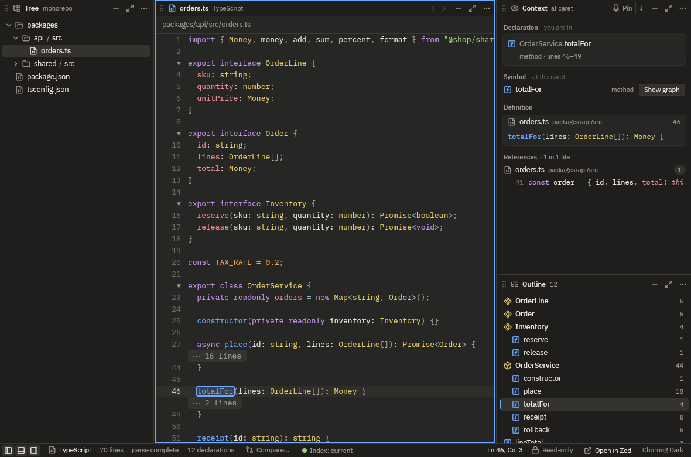

The window is made of panes: the file tree (Tree) on the left, the source in the middle, the context pane and
the outline on the right, and a status bar along the bottom. Each pane has a header, and you can
rearrange them ([Panes and layout](#panes-and-layout)).

## Opening a folder or file

```bash
chorong-app .                          # a folder: the Tree pane shows its tree
chorong-app crates/cho-core/src/buffer.rs   # a file: its folder becomes the Tree root
cho open crates/cho-core/src/buffer.rs  # the CLI hands the target to chorong-app
cho src/lib.rs src/queue.rs tests/queue.rs   # several files: a focus layout, the rest in the tray
git diff --name-only | cho -               # the files named on standard input
cho --name "PR 412 review" src/lib.rs src/queue.rs   # a window titled "PR 412 review — …"
chorong-app 'chorong://open?repo=local:~/code/repo&path=src/lib.rs&symbol=Queue::push'
chorong-app 'chorong://open?repo=github:acme/api&rev=3f9c1e2&path=src/lib.rs&symbol=Queue::push'
```

- A folder opens with its files listed. Click a file to open it.
- **Windows** are titled by their name (`--name`), repository and file count. On macOS the
  Window menu and the Dock icon's menu list them by that title, so several Chorong windows are
  easy to tell apart; Cmd-M minimizes one and Cmd-Q quits Chorong.
  The Chorong menu opens **Settings…** (Cmd-,).
- **Several files** open in one window whose Tree root is the repository holding them (the
  nearest folder with a `.git` above them, or else the folder they share). The first file is on
  a focus page; the others wait in the tray. Tab in Layout mode (`w`) flips through them in one
  spot, and Ctrl-Tab, **Go to Pane…** and Cmd-K then A bring them in too. `cho -` reads the
  paths from standard input, one per line. Files only: a folder or a `chorong://` link opens on
  its own.
- **What Chorong reads.** Only regular files up to 16 MB, and nothing a symbolic link leads to
  outside the opened folder: a link, an index or a symlink in the tree can name any path, so a
  device, a pipe, a huge generated file or `~/.ssh/...` is refused with a message instead of
  read. The CLI and graphs apply the same rule.
- A `chorong://open` link opens the repository, reveals the named symbol (or `line`) and
  selects it. A link that names a repository by its remote (`github:acme/api`) opens a
  clone of it that Chorong has opened before, preferring one already at the link's commit or
  branch. If there is none, a banner says so and offers the page on the web; Chorong never
  clones or fetches by itself. See [url-scheme.md](url-scheme.md) for the link format and
  `cho link build` to make one.
- **A link made at another commit.** Links record the commit they were made at. If your
  checkout has moved since, Chorong still opens the current checkout, finds the declaration by
  name, and shows a banner: "Link made at `3f9c1e2` on `feature/x`; this checkout is at
  `a71d004` on `main`". If the declaration is gone, the banner says "`name` not found at
  `a71d004`" and nothing similar is opened instead. The banner offers **View at 3f9c1e2**
  (the file as it was, read from git, read-only and without an index unless one was built
  at that commit), **Open worktree** (another worktree that has that commit or branch),
  **Rebuild graph** (for links from a graph page), and the `git switch` command to copy.
  Chorong never switches your checkout. A link made at the same commit but with uncommitted
  changes on either side gets a small note instead.

  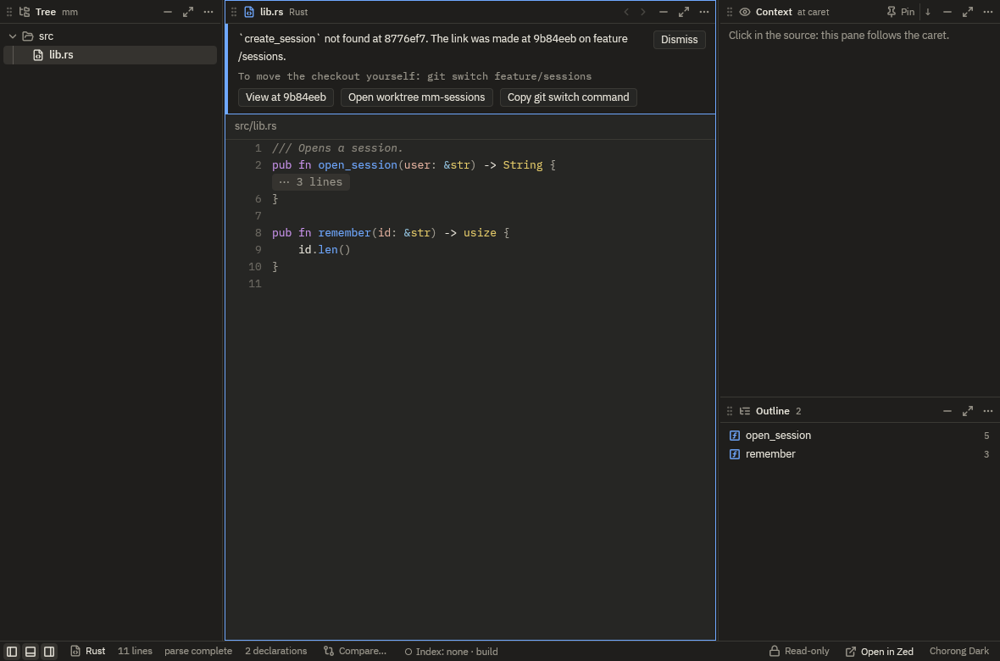
- **Copy a link** to where you are with Cmd-K, then C: it names the declaration at the
  caret, the repository by its remote and the commit, plus the branch and whether there were
  uncommitted changes. **Copy chorong:// Link for Sharing** in the command palette leaves out
  the branch and the uncommitted-changes flag, for links that leave your machine.
- **Sharing a pull-request view.** In a pull-request view (or any Before/After comparison),
  **Copy chorong:// Link** adds the pull request number, the head, the Before and the side you
  are reading, so a colleague lands on the same comparison. Opening such a link asks first
  ("Open pull request #123 of github:acme/api?") when Chorong has not fetched that pull request
  before, and fetches only if you choose **Open**. If the pull request has moved on, the
  commit banner says so; if the version was lost to a force-push, the banner says it is gone
  and the window shows the current head. These parameters are provisional
  ([url-scheme.md](url-scheme.md#pull-request-links)).
- **Clicking a `chorong://` link** in a browser or a graph page opens Chorong once it is
  registered as the link handler (`scripts/install-linux.sh` on Linux, the `Chorong.app`
  bundle on macOS; see [building.md](building.md#registering-chorong-for-chorong-links)). Only
  one viewer runs: the link goes to the window that has its repository open, which comes
  forward, and the jump is recorded so Back returns you. A repository that isn't open gets
  a new window.
- **A link to a folder Chorong has never opened asks first.** Any web page or program can send
  a `chorong://` link, and a `local:` link can name any folder on your machine. If the folder
  is not one you have opened in Chorong, a dialog shows its path and the link; **Open folder**
  (Enter) opens it and remembers it, **Don't open** (Escape) does nothing. Links that name a
  repository by its remote only ever open folders you have opened before, so they never ask.

  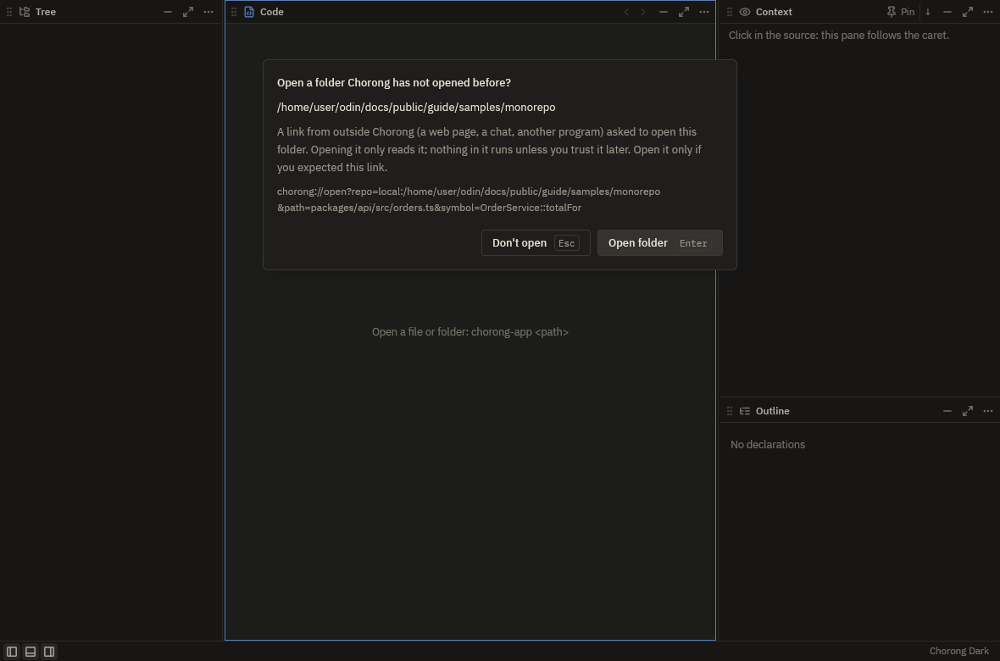
- Options: `--light`, `--theme FILE [--theme-name NAME]`, `--editor PROGRAM`, `--font FAMILY`
  (the code font for this run, over the `appearance.code_font` setting), `--no-fold`.
  Languages: Rust, Swift, TypeScript/TSX/JavaScript, Python and Java (Java 8 fully;
  newer syntax such as records parses too). JSON (`.json`, `.jsonc`), TOML (`.toml`,
  `Cargo.lock`) and XML (`.xml`, `.plist`, `.svg`, `.xaml`, `.xsd`, `.xsl`, `.xslt`,
  `.csproj`) and Markdown (`.md`, `.markdown`; the source, not a rendered preview, with fenced
  code highlighted in any of these languages, e.g. ```` ```rust ````) are highlighted only: no
  outline or call marks, and no folds except JSON's objects and arrays
  ([Reading](#reading)). Other files open as plain text.

## Opening a remote repository

**Open Remote…** (command palette, `Ctrl-Shift-P`) opens a branch, pull request or commit of a
GitHub or Bitbucket repository that you have not cloned. Chorong keeps its own copy in a cache
(see [Remote sources](sources.md)) and never writes to your repositories.

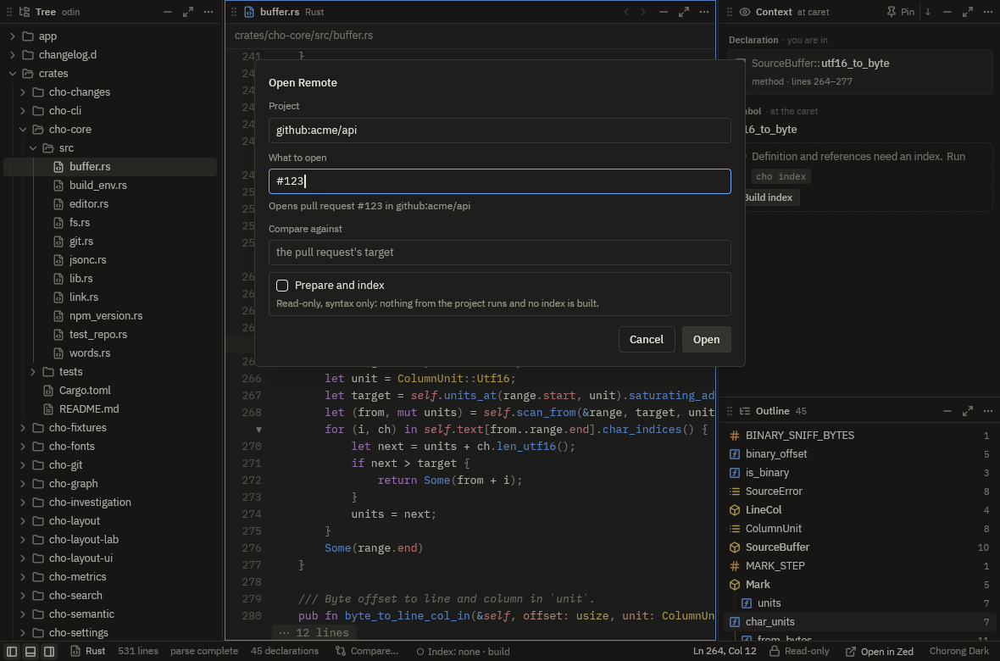

- **Project.** The project you opened in last is selected. Type to filter the list; Up / Down
  and Enter choose. **Add from URL…** takes a repository URL (or `github:acme/api`) and adds
  it as a project when you open: pressing Open is your consent to fetch, and the form says
  "Chorong will add the project".
- **What to open** is one box: a branch (`feat/login`), `#123` for a pull request, a commit
  (`3f9c1e2`), a URL, or nothing for the default branch. Branch names complete from the
  branches Chorong already has for the project (Down to choose one, Enter to fill it in); nothing
  is fetched while you type. A URL that names another repository switches the project row, and
  the hint says so. If a clipboard URL is one Chorong accepts, it is put in the box when the form
  opens; nothing happens until you press Enter.
- **The hint** under the box says what Enter would open ("Opens pull request #123 in
  github:acme/api", "Opens the default branch of ...") or why it cannot ("Not a branch name"). A
  hexadecimal name that could be a commit or a branch is not guessed: Chorong asks which.
- **Compare against** defaults to the default branch, or to the pull request's target. Type a
  branch (completed the same way) or a commit to use it as Before instead.
- **Prepare and index** is a checkbox, unchecked by default and never remembered (Tab to it, Space
  or a click toggles it). Ticking it is your click to prepare and index, for this open only: the
  new window asks the project's approval before it runs anything from the repository; see
  [Prepare and index](#prepare-and-index) below. Unchecked, the window opens read-only with
  syntax only and a banner offering **Prepare and index** and **Index only**: nothing from the
  project runs until you click, not even for a project you approved earlier.
- **Open** (Enter) runs in the background, so the form stays responsive. A progress row shows
  the time spent: the first clone of a large repository can take a few minutes. Escape hides
  the form and the open carries on, and a notice tells you when it finishes; it cannot be
  cancelled yet. Errors appear in the form as the message the backend gave.
- **What happens on success.** The worktree opens in a new window, with the comparison already
  started (Before is the merge base) and the file and line if a URL named one. A window that
  already shows a worktree of the same project is replaced; a window showing any other folder
  is never replaced. Notices say what happened ("Added github:acme/api to your projects").
- **Progress with the form hidden.** While an open runs and the form is hidden, the status bar
  shows "Opening github:acme/api #12… 0:14" with the time spent; click it (or run **Open
  Remote…** again) to see the form and its progress. The clock ticks once a second, and only
  while an open runs.
- **First-open completion.** For a project Chorong has not cloned yet, branch names are asked of the
  remote once when the form opens (never while you type), so completion works the first time.
  Until the backend supports this the form completes from the branches Chorong already has.
- **Bitbucket Data Center.** After you paste a Data Center URL under **Add from URL…**, a
  **Clone URL** box shows the address Chorong derived from it. Edit it if your server serves
  clones from another path; it is checked when you press Open. GitHub and Bitbucket Cloud need
  no such box.
- **Recent folders.** **Open Recent…** lists the folders Chorong has opened, most recent first.
  Cache worktrees read as "github:acme/api · pull request 12". The list is shared with
  `cho open`, so a worktree placed by either appears in it.

### Prepare and index

Nothing is prepared or indexed until you click. A window on one of Chorong's worktrees with no index
shows a banner with the recipe's exact commands, the indexers that would run, that the project's
own code runs, and the last build's duration when there was one. **Prepare and index** (the
primary button) runs the recipe and then indexes; **Index only** indexes without running the
recipe; **Not now** hides the banner for this window (Esc in the code presses it; no key
starts a build). Open Remote's ticked box is the same click
as **Prepare and index**.

Either button, or the ticked box, asks Chorong's backend whether the worktree may be prepared and
indexed. Indexing runs the project's own code, and a remote project often needs its packages
installed first, so one **approval per project** covers both. It is the same approval as
`cho prepare approve` (see [Remote sources](sources.md#prepare)), so either one answers for the
other.

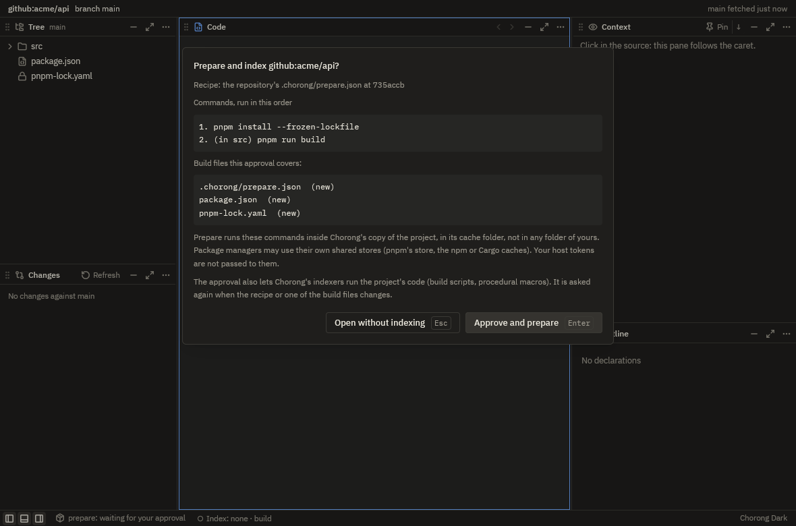

- **Approved and unchanged.** The recipe runs (or is skipped when the last run already covers it)
  and the index is built, with no further question. A project with nothing to prepare is
  indexed directly. **Index only** skips the recipe.
- **Needs approval** (a recipe never approved, or a changed recipe, lockfile, package script,
  `build.rs` or proc-macro crate since you approved). A panel lists the recipe's commands
  exactly as they will run, the build files that are new or changed, and where they run: inside
  Chorong's copy in its cache, not in a folder of yours (package managers may use their shared
  stores, and your host tokens are not passed). **Approve and prepare** (Enter) stores the
  approval (with **Index only**, nothing is prepared after it); **Open without indexing** (Esc, or
  a click outside) leaves the window syntax only, with the banner.
- **Not allowed.** If Chorong cannot read the recipe (for example the project is unknown), the
  window opens syntax only and a notice says why.
- **Running.** The status bar shows "preparing 2/3 pnpm install --frozen-lockfile" with
  **Cancel**; when it ends it reads "prepared" for a few seconds and indexing starts as for any
  trusted folder. Cancelling is silent and leaves the window syntax only, with the banner.
- **A step fails.** A notice (it does not block the window) shows the failing step, the end of its
  output and the log path, with **Copy output**, **Retry** and **Dismiss**. Indexing starts anyway and the index
  reads `partial (prepare failed)`; stop it like any other build. After **Update** moves the
  worktree to a new head, Chorong asks the same questions again only if the box was ticked when this
  window opened or on that Update (approval if the build files changed, prepare only if its last
  run no longer covers them, then indexing); otherwise the banner offers it.

Prepare only ever runs after your click, and after you approve it or when an earlier approval
still covers the commit. `cho open` prepares only with `--prepare`.

### The remote header

A window on one of Chorong's cache worktrees shows a band above the panes saying what it holds.
It is fixed at the top, so it does not move when you switch panes; windows on your own folders
have no band.

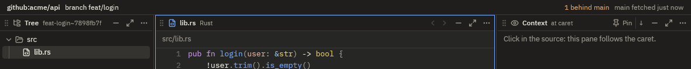

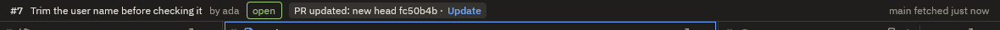

- **Pull request:** `#123`, the title (long titles are cut; hover for all of it), the author, and a
  chip for open, merged or declined. A window opened later from **Open Recent…** or a link has
  only what the cache recorded, so it reads "pull request 12" until Chorong keeps the details.
- **Branch or commit:** the project, and "branch feat/login" or "commit 3f9c1e2".
- **Freshness**, at the right: "3 behind main" when the head lacks commits of the target
  (hover: "must be rebased before merging"), and "main fetched 12 min ago", or "offline · last
  fetch 2 h ago" when the remote could not be reached. The times are worked out when the window
  opens and each time you return to it, not on a timer.
- **Saved details.** When the title, author and state were not read from the host by this open
  (a window reopened from **Open Recent…**, or the host could not be reached), the band says how
  old they are: "details from 3 days ago", however recent. Open the pull request again to
  refresh them.
- **PR updated.** When you open a pull request and each time you return to its window, Chorong asks
  the host whether the pull request has a newer head. If so the band adds "PR updated: new head
  a71d004 · Update"; **Update** opens the new head and puts you back at the same declaration,
  keeping a Compare against override. Chorong never checks in the background. If the host cannot
  be reached the band shows "offline" until a later check works (this is not saved).
- **Open on GitHub / Bitbucket.** In these windows the status bar, the palette and `Cmd-K W`
  offer **Open on GitHub** (or **Bitbucket**) instead of Open in editor. It opens the page for
  the file and line you are reading, on the side you are reading: Before is the merge-base
  commit, After the head. The tooltip explains: "This is Chorong's copy. To edit, open your own
  clone in Chorong." Local folders keep **Open in editor**.

## Finding files

**Picker.** Press Ctrl-P (Cmd-P on macOS). Type some letters of the file name; they match in
order, so `engrs` finds `engine-foo.rs`. The top 50 matches are listed, best first, with the
matched letters highlighted. Up and Down move, Enter opens, Escape closes. Cmd-Enter,
Cmd-Shift-Enter and Alt-Enter open the file in a new code pane to the right, below, or as a new
tab instead ([Where files open](#where-files-open)); in a focus layout it joins the current page.
While a tour is open the picker starts with a **Tour** chip before the query and lists only the
tour's files; Backspace with an empty query (or a click on the chip) lists every file. To put
the chip back, press Tab (or type the start of `tour` and Tab, as the hint shows) or Alt-T.
**Right arrow** opens a **preview** of the highlighted file beside the list (the picker grows to
most of the window's height), and it follows the highlight as you move; **Left arrow** closes
it. It shows the file's first 200 lines in the theme's colours, with a leading run of imports
folded into one row ("⋯ 12 import lines"); an image is drawn as an image, and a binary file says
"Can't preview a binary file". It has no folds and no index, so it stays cheap. The
`picker.preview` setting turns it off ([settings.md](settings.md)); Lightweight mode does too.

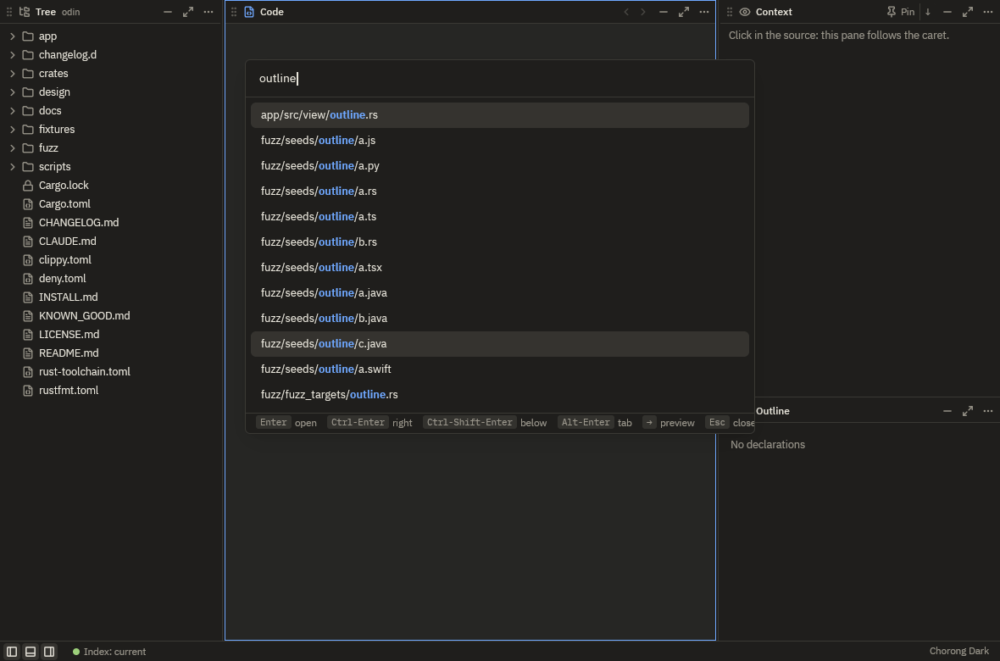

**Tree pane.** Lists every file in the folder you opened. Click one to open it.

**Open a file or folder.** Cmd-O (Open File or Folder… in the palette) shows the system's Open
dialog. A file in the folder this window shows opens here; any other file or folder comes up in
the window that already shows it, or in a new window.

**Command palette.** Press Cmd-Shift-P (Ctrl-Shift-P off macOS), or Shift twice quickly. It lists every command with
its current key binding, filtered as you type like the file picker. Up and Down move, Enter
or Tab runs the command (type "file", Tab, and Go to File opens), Escape closes it. Commands whose feature does not exist yet are listed
too; running one says "not available yet" in the status bar.

In the pickers, the palette, project search, the find bar and the Open Remote boxes, the query takes the
usual text keys: Cmd-A selects it (typing or pasting replaces it, an arrow key deselects), Cmd-C
copies a selected query, Cmd-V pastes, Backspace deletes a character or the selection,
Option-Backspace the last word (Ctrl-Backspace off macOS) and Cmd-Backspace the whole query.

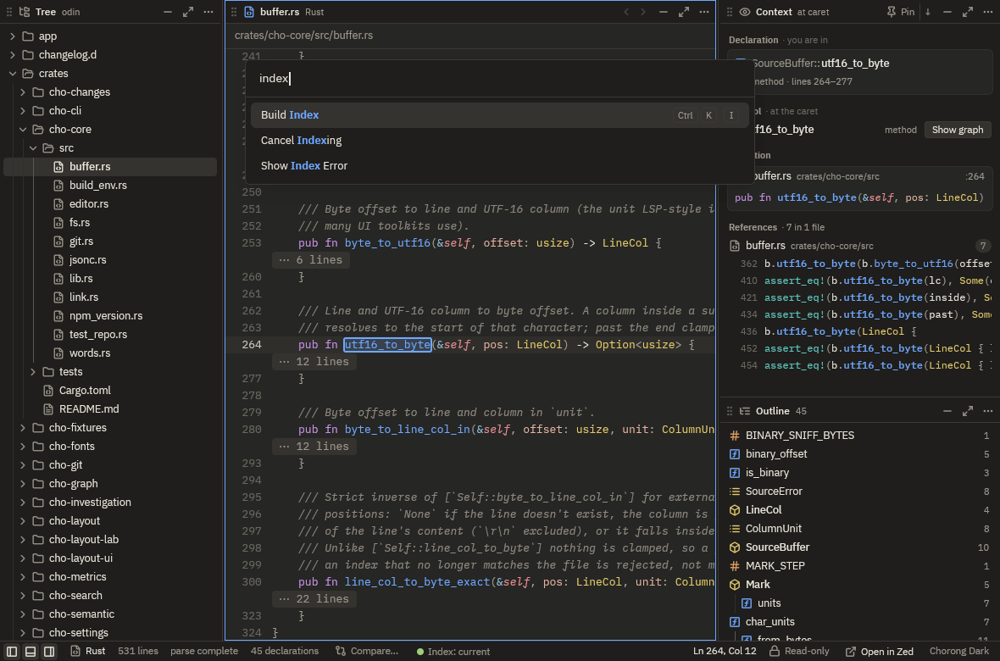

**Chords.** Cmd-K starts a chord for commands that change how you view the code, never where
you are. A popup lists the keys that can follow. Take your time: GPUI gives up on a chord
after one second, but the popup then holds it open until you press the next key (a key that
follows nothing just closes it).

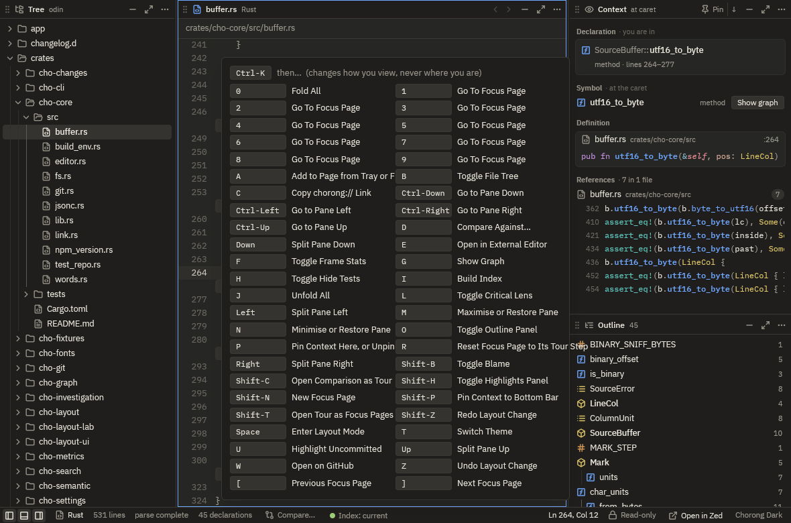

**Cheat sheet.** Press `?` in the code view for every binding, read from the live keymap.

**Tree.** The Tree pane shows the folder as a tree: folders first, then files, each
alphabetically. Click a folder to open or close it. A chain of folders that each hold only one
folder shows as one row (`fuzz / fuzz_targets`). Each file has an icon for its type (source,
config, text, lockfile). Opening a file from anywhere opens its folders and scrolls it into view;
the open file's row is highlighted, and the indent guide of its folder is drawn brighter.
Right-click a file to show its graph.

**Search.** Press Ctrl-Shift-F (Cmd-Shift-F on macOS) to search the contents of every file in
the folder. The search panel replaces the tree in the Tree pane. Type a query: the
search starts about 150 ms after you stop typing, runs in the background and is replaced
by a newer one if you keep typing. Results are grouped by file, with the match highlighted
and a count per file. The summary line gives the number of results and files; at most 5,000
matching lines are returned, and the summary says when it stopped there.

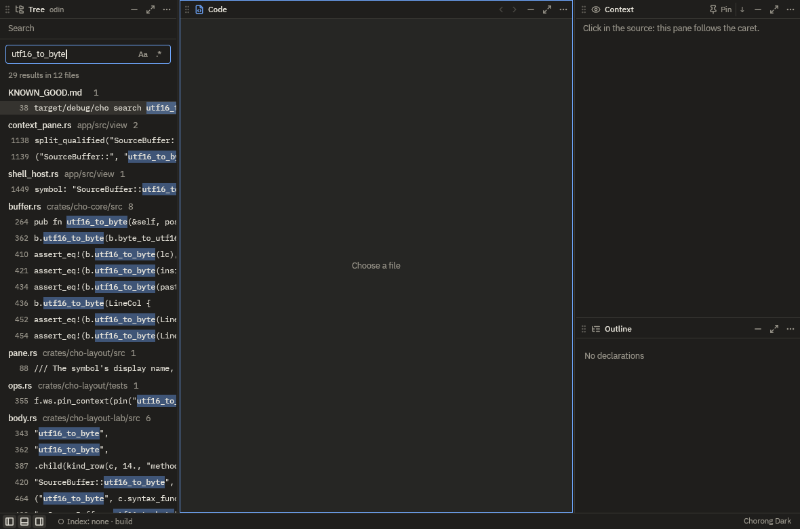

- It matches the text literally and ignoring case. **Aa** (Alt-C) makes it case-sensitive and
  **.\*** (Alt-R) reads the query as a regular expression; an invalid expression is reported in
  the summary line.
- While you compare with a branch, **Changed** limits the search to the files the comparison
  changed (the files of the [Changes list](#the-changes-list)), so you can look for a name in the
  change alone.
- Files that `.gitignore` excludes, hidden files and binary files are skipped.
- **Full screen:** press Ctrl-Shift-F again (Cmd-Shift-F; a quick double press works) while the
  search box has the keyboard, and search fills the window: the results on the left and, beside
  them, the selected result's file from a little above its line, with the line tinted (the same
  preview as Go to file, `picker.preview`). Press it again, or close the search, to put the
  layout back. From inside a focus layout of your own it asks you to leave focus first.
- Up and Down move through the results, Enter or a click opens the file at the first match on
  that line. History records the jump, so Alt-Left returns you. Clicking in the source
  returns the keyboard to the source; Escape closes the panel and shows the tree again.
- The same engine is available without the viewer as `cho search`. See [cli.md](cli.md).

**Find in file.** Press Ctrl-F (Cmd-F on macOS) to search the open file. A find bar opens at
the top of the active code pane, with the last query you used selected (typing replaces it).
Matches are found as you type, in the file you are reading only, and the caret moves to the
first match from where it was. The bar shows which match the caret is on and how many there
are ("14 of 45"), or "No matches".

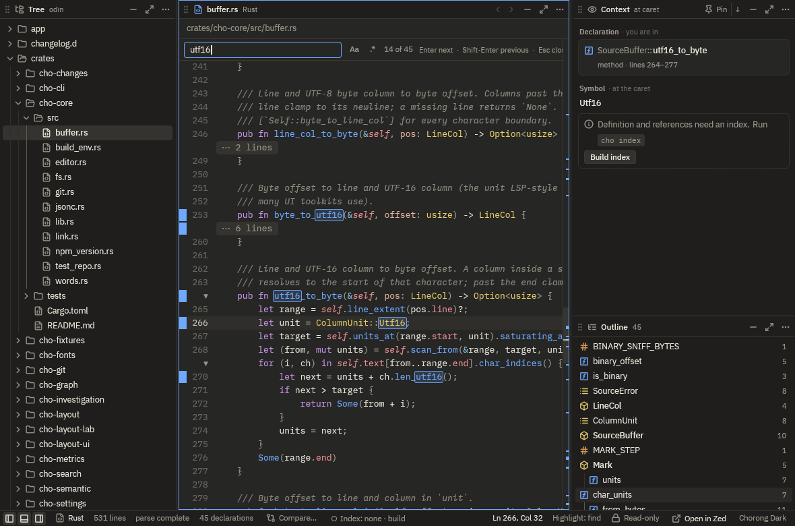

- It matches the text literally and ignoring case, like project search. **Aa** (Alt-C) makes it
  case-sensitive and **.\*** (Alt-R) reads the query as a regular expression (`^` and `$` match
  at line ends); an invalid expression is reported in the bar, in place of the count.
- Enter goes to the next match and Shift-Enter to the previous one, wrapping at the end and the
  start of the file. A match inside a folded block opens the fold.
- The matches are a [highlight group](#double-click-to-highlight) named after the query, so they
  are marked in the gutter, the [overview lane](#the-overview-lane) and the
  [minimap](#the-minimap), and `n` / `N` step through them in the code view as well.
- Clicking in the code gives the keyboard back to the code and leaves the bar open; Ctrl-F (Cmd-F)
  again returns to the bar and selects its query. Escape closes the bar and removes its
  highlight group; so does removing the group (Escape in the code view, or its chip's cross).
- Each code pane has its own bar. At most 10,000 matches are marked ("10000+" says there were more).

**Outline.** The pane at the bottom right lists the file's declarations, indented by scope
with indent guides. Each row has a glyph for its kind, in the colour that kind has in the code
(hover a row for the kind word), the name and the line count. Types and `impl` blocks are drawn
slightly bolder, and the declaration holding the caret has an accent bar at its left edge.
Click one to jump there and select its line.
Cmd-K, then O folds the outline to its header or unfolds it (Cmd means Ctrl on Linux and
Windows; see [Key bindings](#key-bindings)). The context pane above it stays. Cmd-Shift-O lists the same
declarations in a picker.

## Panes and layout

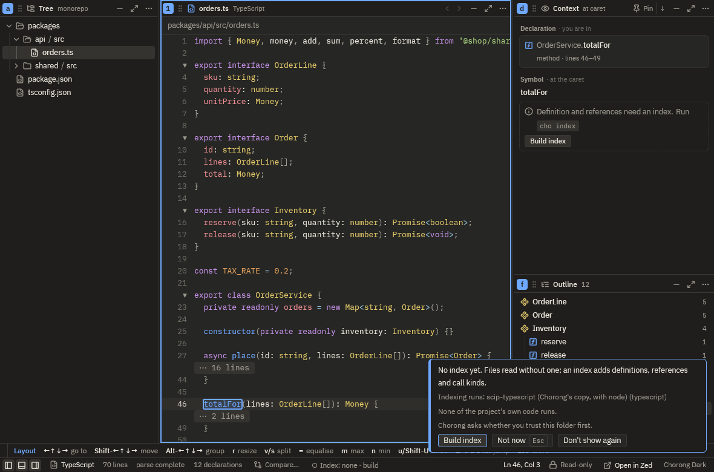

Every pane has a header with its title, a short note (the Outline's declaration count, whether the
context pane follows the pointer or the caret) and three buttons: minimise, maximise and a menu
(`…`). The panes live in three **docks** (left, right and a bottom bar, empty at first) around the
code area.

- **Move** a pane by dragging its header. A highlighted zone shows where it will land: the edge
  of another pane splits it, the middle adds a tab, and a dock accepts it. Drops that the layout
  cannot honour show no zone.
- **Resize** by dragging the thin handle between panes or beside a dock.
- **Minimise** folds a pane to its header (click again to unfold). **Maximise** shows one pane
  alone; Escape or the focus bar's **Exit focus** button brings the others back.
- **Close pane** is in the pane menu; Cmd-K then Z undoes it. In a focus layout, it sends the pane
  to the tray instead, so it can come back; closing a pane that is already in the tray closes
  it. **New Code Pane** (command palette) opens an empty code pane, as a new tab in the
  code area or beside the focused pane on the current focus page; Cmd-P then opens a file in
  it. A closed File Tree, Outline or Context
  pane comes back in its usual place with **Toggle File Tree** (Cmd-K B), **Toggle Outline
  Panel** (Cmd-K O) or **Show Context Pane** in the command palette; in a focus layout it
  joins the current page. **Send to tray** (`t` in Layout mode) parks a pane in the tray of the
  focus bar, from where you can put it back.
- **Dock toggles** at the left of the status bar show or hide the left dock, the bottom bar and
  the right dock.
- Panes for call stacks that you create from the layout say they are not available in the
  viewer yet. Pins are real panes: see [Pinning](#the-context-pane) below.

**Focus layouts and pages.** Maximise a pane (Cmd-K then M, `m` in Layout mode, or its maximise
button) to look at it alone. The docks hide and a focus bar at the top says `Focus layout`, lists
what is on screen and has **Exit focus** (or Escape). Everything else waits in the **tray**
at the bottom, from where you can drag it in beside or below what is on screen. A focus layout
can hold several **pages**, each its own arrangement, shown as `1 2 +` in the focus bar:

- **+** (or Cmd-K then Shift-N) adds a page. It starts with the focused pane, taken from the
  page it was on; if that pane was alone there, the new page starts empty and you drag panes to
  it from the tray. **New Focus Page** from the palette or Cmd-K then Shift-N also works from the
  normal layout, where it starts a focus layout with the focused pane; either way the tray
  picker then opens, so you pick the panes the page needs one after another (Escape when done).
- To put source files on the page, press Tab in the tray picker (or type `f` and Tab: the
  start of "files" shows the rest, and Tab takes it). The file picker that opens adds each file
  you choose in a new code pane on the page, Enter to the right and Shift-Enter below, and stays
  open for the next one. A **Files** chip before the query shows the mode: Backspace with an
  empty query (or a click on the chip) removes it and goes back to the tray; Escape ends it.
  When the tray is empty, the file picker opens straight away.
- To add more to the page you are on later, press Cmd-K then A (**Add to Page from Tray or
  Files…** in the palette): the same tray picker, with Tab for files.
- Cmd-K then ] and Cmd-K then [ go to the next and previous page; Cmd-K then 1 to 9 jump to a
  page by number. Clicking a page's number shows it, and dropping a pane on a number sends it
  there. The pane you were reading in, and where you were in it, carries across pages.
- Cmd-K then R resets a page made for a tour step to the panes the step declares (pages you
  make yourself have nothing to reset to).
- **Exit focus** ends every page and puts each pane back where it was, keeping the file and caret
  you reached. Each focus layout you end is kept in **Reopen Focus Layout…** (in the command
  palette, or `h` in Layout mode), up to 20 per repository, and the list comes back after a
  restart.
- Cmd-K then Z undoes a layout change (including entering or ending a focus layout, adding or
  closing a page), and Cmd-K then Shift-Z redoes it.

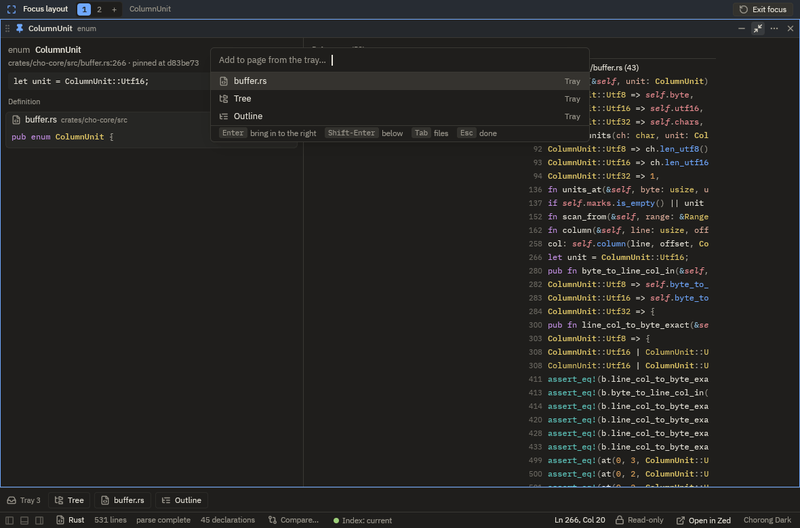

**Split code panes.** Split a code pane with `v` (side by side) or `s` (stacked) in Layout mode, with
Cmd-K then an arrow key, `Cmd-\`, or the pane menu's Split right and Split down.

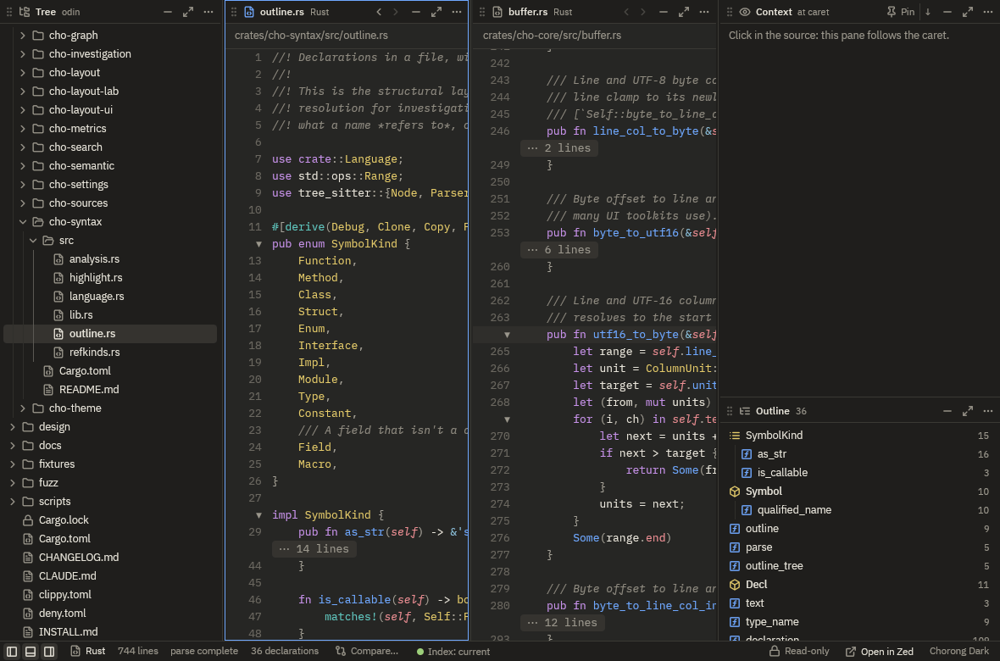

### Where files open

Everything that opens a file (the file picker, the symbol picker, the references and Changes
lists, search results, the file tree and Cmd-click to a definition) follows one rule: plain
Enter or a click replaces what the active code pane shows, and a modifier opens a new code pane
instead. Cmd means a new pane; adding Shift puts it below instead of to the right.

| Key | Mouse | Opens |
| --- | --- | --- |
| Enter | click | in the active code pane, replacing what it shows |
| Cmd-Enter | Alt-click | in a new code pane to the right |
| Cmd-Shift-Enter | Alt-Shift-click | in a new code pane below |
| Alt-Enter | | in a new tab beside the active code pane's |

Cmd-click goes to a definition, so the mouse uses Alt for placement: Cmd-Alt-click opens the
definition in a new pane to the right. Off macOS, Cmd is Ctrl. New panes stand beside the active
code pane; in a focus layout, beside the focused pane on the current page.

**Across a whole edge.** A pane can also span a whole edge of the code area (or of a focus page),
under or beside every group there, such as a full-width row at the bottom. It starts with a third
of the space. While you drag a pane, slim targets appear along the edges for this, except where
one group already runs the whole edge (dropping beside it does the same).
**Move Pane to…** lists it as `Whole width, bottom` on a focus page and `Code area width, bottom`
in the normal layout (and top, and the heights at left and right), and in Layout mode Shift with
an arrow does it when the pane is already at that edge with nothing further that way. In the
normal layout the code area stands between the side docks, so its width isn't the window's: the
row across the whole window is the bottom bar, which holds tool panes such as References.

On a trackpad, the source and the lists in the side panes (Tree, Outline, Search, Changes,
Context, Pins) stretch when a scroll runs past an end and spring back when you let go, as elsewhere on
macOS. The `scroll.overscroll` setting turns this off, and Lightweight mode does too.

Each code pane keeps its own file, caret, folds, highlight groups, scroll position and
back/forward history (Alt-Left and Alt-Right act on the active pane). A new split starts as a copy of the
pane it came from. The **active code pane** is the code pane you last clicked or moved focus to
(Layout mode arrows move focus between panes). The Context pane, the Outline, the status bar
(line, column, language) and the commands (go to definition, references, graph, copy link, fold,
highlight) all follow the active code pane, and files opened from the tree, the picker, search
results or a link open in it. Closing the active code pane makes the most recently used one active.

**Layout mode** is the keyboard way to do all of this. Press `w` in the source (or Cmd-K, then
Space). A hint bar above the status bar lists the keys: the arrow keys move focus between panes,
Shift with an arrow moves the pane, Alt with an arrow moves its whole group (hold Shift or Alt
and the places each arrow would move it to light up, marked with the arrow), `v` and `s` split,
`m` maximises, `n` minimises, `x` closes, `t` sends to the tray, `r` resizes with the arrows,
`=` evens the sizes, `u` undoes, and the labels on the panes jump to them (digits for code panes,
then letters). In a focus layout, **Tab** and **Shift-Tab** flip through the files in the tray:
the next file takes the focused spot and the one there goes back to the tray, in the order the
files were opened, so the page stays as it is. The tray's chips get labels too, carrying on
from the panes on screen; pressing one brings that pane up the same way, and the mode stays
open for the next. `w`, Enter or Escape leaves the mode. Outside the mode, Cmd-B, Cmd-Alt-B and Cmd-J
toggle the left dock, right dock and bottom bar, Cmd-K then Z undoes a layout change, and
Cmd-1 to Cmd-9 focus code groups. Every key is in the keymap file ([`app/keymap/default.json`](../../app/keymap/default.json)).

**Finding a pane.** Hold Ctrl and press Tab to open a switcher of the panes you used most
recently, docks included; keep Tab down to step through it, Shift-Tab steps back, and releasing Ctrl
switches. A single Ctrl-Tab goes back to the previous pane, and again returns.

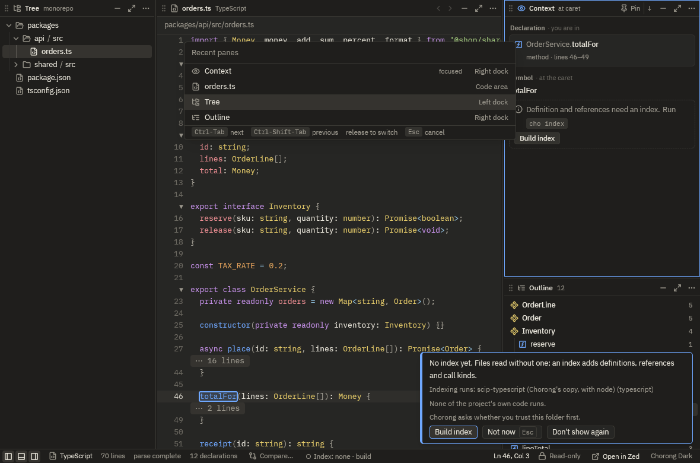

In the command palette (Cmd-Shift-P), **Go to Pane…** lists every pane with where it is (`Right dock`,
`Code area`, `Tray`, with `hidden` or `minimised` when that applies). Type to filter and press Enter:
the pane's dock is shown, its group unfolded and the pane focused. **Move Pane to…** lists the places
the focused pane could go (`Left dock`, `Beside Outline (below)`, `Tab in Context`), and **Add to Page
from Tray or Files…** (Cmd-K then A) lists the tray in a focus layout; Enter puts the pane to the right
of the focused one and Shift-Enter below it, and Tab switches to adding files to the page. `p` and `b` in Layout mode open the last two.

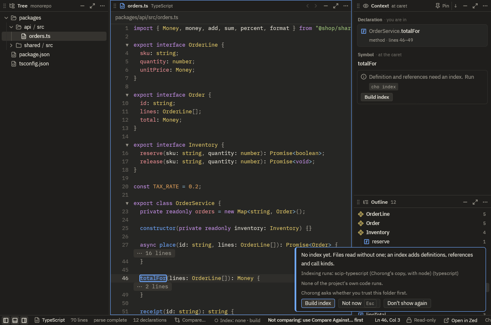

**Dock sizes.** Ctrl-Alt-= and Ctrl-Alt-- grow and shrink the dock that holds the focused pane
by 24 px; Ctrl-Alt-0 resets it. Repeated presses undo as one step.

The layout is saved for each repository and comes back the next time you open it, with each
code pane on its file and at its caret. Damaged or
unusable saved layouts are ignored and the default layout is used. The setting
`layout.autosave` ([settings.md](settings.md)) turns that off, and `debug.frame_overlay` draws
frame times over the window; Cmd-K then F toggles it. Optional features that work as you move
the pointer or in the background (following the hover, references, highlight lookups, call
colours, automatic indexing) can be switched off in `settings.json`, or all at once with
`"lightweight": true`; a running viewer notices within a second.

## Reading

Function and method bodies longer than three lines start folded: you see the signature, a
`⋯ N lines` row and the closing line. Other blocks fold too, and start open: anything between
`{}`, `[]` or `()` that spans more than three lines (type and `impl` bodies, `if`/`else` and
loop bodies, object and array literals, long argument lists), Python's indented blocks, and
a run of imports at the top of a file. The folds come from the syntax, so the same file
always folds the same way. Click the row, or the signature line's number (it turns
into ▸ under the pointer), to open a fold. An opened fold shows ▾ in place of its line number
(point at it for the number); click it to fold the body again. Space or Enter toggles the fold
at the cursor. Left and Right work as in a file tree: Left folds the open block on the selected
line, or, inside a block, moves up to its first line (Left again folds it); Right opens a
folded block, or steps into an open one. Opening a location inside a fold (from the outline, a link or a reference)
opens that fold. Start with everything open using `--no-fold`. Fold state lasts for the
session, per file.

**Fold All and Unfold All** (Cmd-K 0 and Cmd-K J, or the palette) collapse or expand every fold
in the file at once. Fold All folds the outermost blocks too; Right on the first line then opens
one level at a time.

**JSON.** In a `.json` or `.jsonc` file every object and array that spans more than three lines
folds, from the line of its `{` or `[` to the line of its `}` or `]` (comments in JSONC are
fine). JSON files open with nothing folded; Fold All collapses them, and Space, Enter, Left and
Right work on a line as in code. A file over 256 KB shows at once and its fold marks appear a
moment later, once the background parse ends (about 70 ms per MB); a Fold All pressed before then
runs when they arrive. The `editor.json_folds` setting turns JSON folds off (they are off in
Lightweight mode).

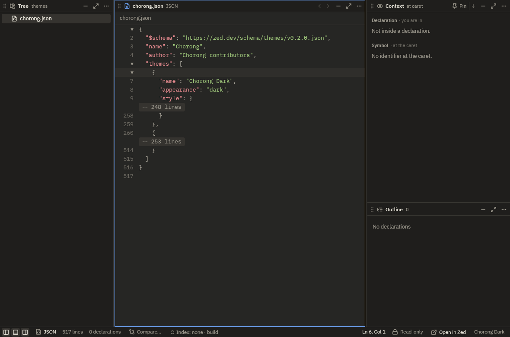

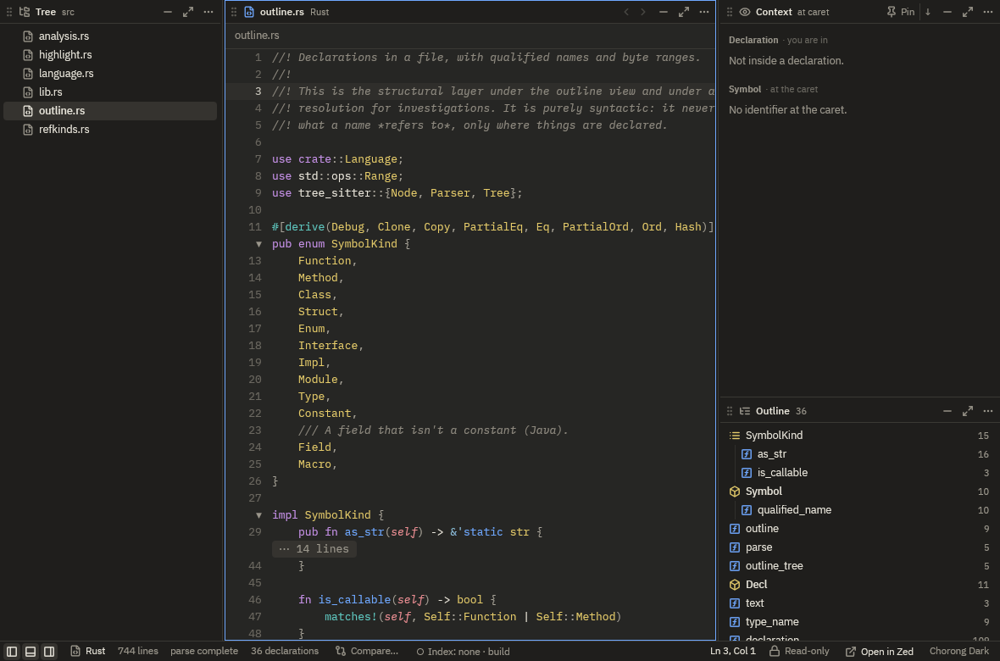

- **Select a line** by clicking it, or with Up and Down. On a plain line the selected line is
  filled grey; inside a tint (a tour step, a chunk, a comparison's changes) it keeps the tint
  and gets an accent bar at the code's left edge and a bold line number. Selection skips folded lines and
  keeps the line in view. Space (or Enter) on a folded signature toggles its fold; `[` and `]`
  jump to the previous and next declaration.
- **Select and copy text.** Drag across the code to select any span, across lines; dragging
  past the top or bottom of the pane scrolls it, faster the further out the pointer goes.
  Shift-click extends the selection (or selects from the caret), a double-click selects a word
  (and still toggles its [highlight](#double-click-to-highlight)), a triple-click selects the
  whole line. Cmd-A (Ctrl-A off macOS) selects the whole file. The selection is drawn in the
  theme's selection colour over any tint, and a folded body inside it shows its `⋯ N lines` row
  selected. Cmd-C (Ctrl-C) copies the selection, or the caret's whole line when nothing is
  selected; the copy is the file's own text, tabs and folded lines included. **Copy with
  Location** (Cmd-Shift-C, Ctrl-Shift-C off macOS) copies a header naming the file and lines,
  then the text in a fenced block tagged with the file's language, ready to paste into a chat
  or a review:

  ````text
  src/server.rs:25-29
  ```rust
  …the selected lines…
  ```
  ````

  Esc clears the selection first; the next Esc removes highlights as before. Clicking anywhere,
  or moving with Up and Down, also clears it. On macOS the **Edit** menu has Copy, Copy with
  Location and Select All.
- **Back and forward.** Cmd-[ and Cmd-] (Alt-Left and Alt-Right also work off macOS) walk through where
  you have been. Opening a file, using the outline, the picker, a link or a reference all
  count. Back restores the exact line; navigating after going back drops the forward trail.
  Each code pane's header has ‹ and › buttons (greyed when there is nowhere to go), and a
  mouse's back and forward buttons do the same, as does a three-finger swipe where macOS is set
  to send one.

### The minimap

A code pane maximised on its own (Cmd-K then M) gets a minimap, and so does each of two code
panes side by side on a focus page when each is at least 640 px wide (another kind of pane on
the page, or a third pane, turns them off): a 100 px strip at its right
edge drawing every row of the file in miniature, two pixels per row, in the syntax colours, so
you can see the shape of a long file and where you are in it. Folded bodies stay folded in the
strip. A frame shows the part on screen.

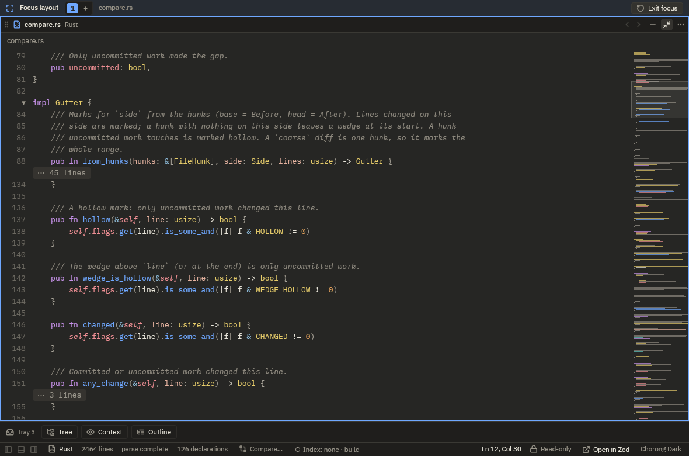

- **Click** the strip to centre the code on that row; **drag** to scroll (the frame follows
  the pointer); the wheel or trackpad over the strip scrolls the code.
- In a file longer than the strip, the strip scrolls too, in proportion: the start of the file
  is at its top when you are at the start, and the end at its bottom when you are at the end.
- While comparing, changed lines show as a bar at the strip's left edge (hollow for uncommitted
  work, as in the gutter), and highlight groups show in their colours.
- `editor.minimap` (on) turns it off; `editor.minimap_always` (off) shows it in every code pane
  at least 640 px wide, not only a maximised one. Lightweight mode turns it off
  ([settings](settings.md)).

### The overview lane

A code pane with a highlight group, or one showing a comparison, has a 10 px lane at its right
edge (outside the minimap when both show); it goes when the last group is cleared. It maps the
whole file to its height and never scrolls, so it shows at a glance where things are:

- each highlight group's occurrences, in the group's colour (an occurrence inside a folded body
  shows at the fold's line);
- changed lines while comparing, in a narrow column at the lane's left edge (hollow for
  uncommitted work);
- the part on screen as a faint band, and the caret's line as a bar.

Click the lane to centre the code on that place. `editor.overview` (on) turns it off, and
Lightweight mode does ([settings](settings.md)).

## Comparing with a branch

Compare Against… compares the **whole repository** (every file, not just the one open) with
another branch, tag or commit, from where your work left it: the Changes pane lists every file
and declaration that differs, and each file you open shows its Before and After. It reads git's
object store only: nothing is checked out, and the working folder is never touched.

Start it from the palette, with Cmd-K D, or with **Compare…** in the status bar (shown in a git
folder while you are not comparing). From a terminal, `cho PATH --compare main` opens straight
into a comparison with `main` ([cli.md](cli.md)). A pull request opened with Open Remote or a
link starts comparing by itself.

1. **Compare Against…** lists local branches, remote branches and tags, each labelled with its
   kind. The default branch (the one the remote's HEAD names, else `main` or `master`) comes
   first, then your current branch's upstream, then the rest by kind and name. A remote branch
   is left out when a local branch of the same name is at the same commit. Type to filter, or type a commit id of 4 to 40 hex digits to compare with that
   commit. Chorong finds the merge base of your current commit (HEAD) and your choice, and says
   so: "Comparing with main: Before is 3f9c1e2, the merge base". If history has several merge
   bases it uses the newest and says so.
2. **Switch Before/After** (`b`, or the palette) flips the side for the whole window: every
   code pane that is not half of a split goes to the other side, and files you open afterwards
   open on that side (a Changes row still opens a removed declaration on Before and an added one
   on After). The view stays where it was: the caret's line keeps its place on the screen, or,
   if you had scrolled away from the caret, the line at the top stays at the top (matched
   through the diff). A file not on screen (in the focus layout's tray, a hidden tab) switches
   when you bring it back, and comes back where you left it. After is the file in your working folder. Before is the same file at the merge base (following a rename), shown
   with syntax highlighting only: definitions, references and the Critical Lens use an index
   only if the cache holds one built at exactly that commit, as for any file read from git.
   A file that is new in your branch has no Before; Chorong says so and stays on After. The other
   side is prepared in the background when you open a file while comparing, so the switch is
   immediate. Each code pane shows a chip in its header (`Before · 3f9c1e2` or `After`).
3. **The place is kept by declaration.** The innermost function, method or type around the
   caret is found on the other side by its qualified name and kind, and the caret keeps its
   line offset inside it, and its column within the line. If the declaration exists on one side only, the caret goes to the
   matching position through the line diff and a notice says "`name` was added in this change"
   or "`name` is removed in this change".
4. **Change highlights** show up while comparing. On After, a green bar in the gutter and a
   faint green tint across the line mark lines added or changed since the merge base; on
   Before, a red bar and a red tint mark lines that were removed or changed. Where the other
   side has lines this side lacks, a thin rule runs across the code on that line boundary, with
   a triangle in the gutter: red on After (lines were removed here), green on Before (lines
   were added here). Rest the pointer on the rule to see how many lines ("3 lines removed
   here"); click it to see them: the pane switches to the other side at that spot (in Compare
   Side by Side, the other column scrolls there instead). A diff too large to compare line by
   line is shown as one change.

   **Changed words.** When a changed line is a light edit of a line on the other side, the
   words that differ get a slightly darker block on both sides (`"s-{user}"` becoming
   `"session-{user}"` marks `s` and `session`). Chorong pairs an old and a new line only when at
   least half their words are the same, so unrelated lines in one change are never compared;
   it marks no words when more than half of a line's words changed (the tint says enough), and
   joins changed words that are one or two words apart into one block. A line that differs
   only in whitespace gets no block; resting the pointer on its gutter bar says "Whitespace
   only".

   The tint's strength is the `compare.line_highlight` setting: `off` (gutter marks only),
   `subtle` (the default) or `stronger`; the word blocks are `compare.changed_words` (on by
   default). Both are off in Lightweight mode ([settings.md](settings.md)).
5. **Uncommitted work is told apart.** After is your working folder, so it can hold edits that
   are not committed yet. Lines only uncommitted work changed keep the side's tint, and in the
   gutter each run of them has one yellow bracket (the theme's "modified" colour) instead of
   green bars, with yellow line numbers. A deletion made by uncommitted work is the usual red
   rule with a yellow tick at that spot in the gutter. On Before, lines that uncommitted work
   removed or changed get the bracket too. A line changed by both counts as committed. The code
   pane's header counts them (`3 uncommitted`): click the count, or press `u` and Shift-U, to go
   to the next or previous one, wrapping round. **Highlight Uncommitted** (Cmd-K U, or the
   palette) tints those lines yellow and dims the other changes, until you press it again.
   Untracked files are uncommitted additions; gitignored files are left out. An uncommitted
   rename counts as a removed and an added file in the status bar.
6. **The status bar** says which side the active pane shows: `After · working folder · 2 files
   differ from the last commit` (or `· clean`), or `Before · 3f9c1e2 · merge base with main ·
   syntax only`. The count is taken when a comparison starts, when the window is activated again
   and after a file opens, never polled. **Open in editor** on Before opens the working copy at
   the matching line.
7. **Choosing another branch** while a pane is on Before keeps it on Before, at the new merge
   base and the same declaration; it returns to After (with a notice) only if the file is not
   at the new base.
8. **Stop Comparing** clears the comparison; panes on Before return to After at the same
   declaration.

**Compare Side by Side** splits the active pane: Before on the left, After on the right, the same
file, each column with its own side chip in the header and a chain icon beside it (a column's
header leaves out the Back and Forward arrows to keep the chip whole; their keys still work). The two are
linked by declaration: when the caret moves into a different function, method or type in one
column, the other column moves to the same declaration (same offset inside it, same column),
without taking focus, and the declaration it lands on is highlighted briefly so your eye finds it
(the `compare.follow_highlight` setting: `fade`, the default; `outline`, a still outline for less
motion; or `off`; off in Lightweight mode). A declaration that exists on one side only takes the
other column to the matching line through the diff. Scrolling does not link, and moving within
the same declaration does nothing. Click the chain, or use **Link or Unlink Split** (`Shift-B`),
to turn the following off and on: a broken chain means unlinked, and the status bar says `linked`
or `unlinked` next to the side.

Opening another file in either column, from the Changes list, the tree or anywhere else, loads
it in both columns and keeps the pair; the column on the side of a Changes row's declaration
lands on it and the other follows. A file new in your branch has no Before, so the pair ends
there, with a notice. The pair also ends when either column is closed and when you stop
comparing; `b` leaves it alone. A column in a pair keeps no prepared copy of the other side.

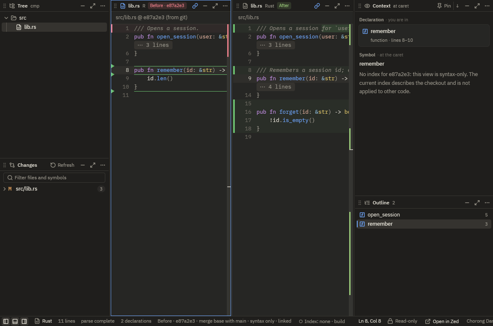

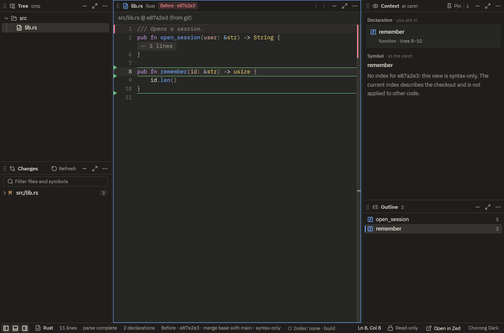

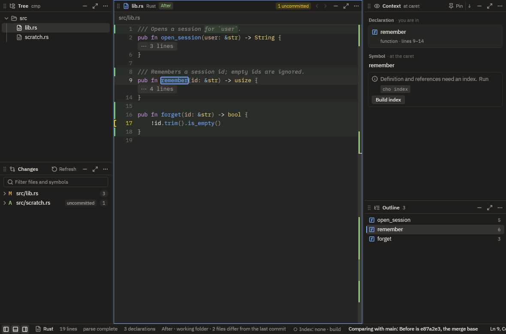

### The Changes list

The Changes pane opens by itself, in the left dock under Tree, when a comparison starts (Compare
Against…, or a pull request opening); **Show Changes** (command palette) brings it back and puts
the keyboard in it. While you compare, it lists every file your branch changed since the merge
base, sorted by path, and under each file the functions, methods and types it touched. Files
start collapsed, so the list reads as a list of files: Right (or the arrow beside a file) expands
one, Left collapses it, and **Expand All Changes** / **Collapse All Changes** (palette) do all of
them. A file row starts with a letter for its status, `A` added, `M` modified, `D` deleted, `R`
renamed (shown `old → new`), then its path, an `uncommitted` label when only uncommitted work
changed it, and a count of its changed declarations. A file with changes but no declarations (a
document, a configuration file) still appears, with its number of changed regions. Each
declaration row has a mark whose shape says how it changed, `+` added, `~` changed, `−` removed,
then its kind icon and qualified name, and an `uncommitted` tag when uncommitted work touches it.
A name that several declarations share (an overload, a repeated name) is marked `ambiguous` and
listed with every candidate on After and on Before, each opening its own declaration; Chorong never
picks one for you.

**Filter the list** by typing while it has the keyboard (or click the box at its top): the query
matches file paths and declaration names fuzzily, the way the file picker does. A file stays when
its path or a declaration in it matches, and a collapsed file then shows just its matching
declarations. Esc clears the filter; pressed again, it returns the keyboard to the code.

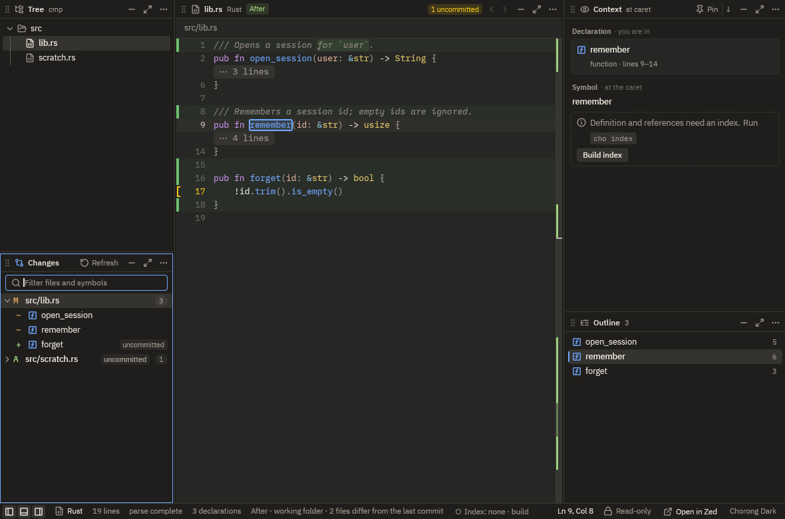

Click a row, or move with Up / Down and press Enter. A removed declaration opens on Before (at
the file's old path after a rename); an added or changed one opens on After; a file row opens
on After at its first changed region (on Before for a deleted file), and expands. The row opens in the
active code pane, so the gutter marks and the side chip are those of any file opened while
comparing. The list keeps the keyboard, so the next row is one key away; Esc returns it to the
code. If a declaration is no longer in the file (you edited it since), Chorong says so instead of
guessing at another.

The list is worked out in the background when a comparison starts, when you choose Show Changes,
when you press **Refresh** in the pane's header, after Stop Comparing (which clears it), and when
the window is activated again; it is never polled, and only while a Changes pane exists. Opening
a file does not recompute it. The activation refresh is the `changes.auto_refresh` setting
([settings.md](settings.md)): it re-diffs the whole comparison, about 15 ms on a small repository
and about 2 s on a large one. With the setting off, and always in Lightweight mode, the window
being activated only makes the pane say "May be out of date" until you press Refresh. While it
runs the pane says "Computing changes…"; when you are not comparing it says how to start. It
reads the repository and your working folder and changes neither.

## The reading loop

The reading loop is how you follow a name through code: find it, see where else it is
used, see what the function calls.

### Double-click to highlight

Double-click an identifier (or press `h` with the cursor on it) and Chorong highlights it, in a
colour from the theme's palette. Do it again on another and it gets its own colour, so several
highlights coexist. Double-click a highlighted name to remove its highlight. `n` and `N` jump
to the next and previous occurrence in the newest group; Esc removes the newest group and,
pressed again, all of them (while text is selected, the first Esc clears the selection). The
double-click also selects the word, so Cmd-C copies it at once. **Clear Highlights** in the command palette removes them all at
once.

Each occurrence is a **marker**: a rounded box behind the word with a thin outline in the
group's colour and a light fill. The box is padded without moving any text, and the syntax
colours stay as they are. Colours are drawn from the theme's player colours, ordered so the
first three are blue, orange and purple, and skipping any that look like the selection or the
current line. Where the declaration of the symbol is known, its box has a heavier outline:
with an index, the occurrence the index marks as the definition; without one, the single
`let`, `const` or parameter among the matches. If the choice is ambiguous (the name is
declared twice, say) no declaration is marked rather than guessing.

The gutter marks highlighted lines too: a bar in the group's colour at its outer edge, split
into segments when a line holds several groups (up to three) and a little wider on the
declaration's line. A folded body that hides a highlight shows the bar on its `⋯ N lines` row,
so nothing you highlighted is out of sight. While comparing, the comparison bar keeps the edge
and the highlight bar sits just inside it. **Gutter: on/off** in the Highlights pane's header
turns the marks off and on (the `highlight.gutter_marks` setting; on by default).

Highlighting has two modes. The status bar says which one is active, as `Highlight: ...`:

| Status bar | Meaning |
| --- | --- |
| `Highlight: same name in method` (or function, class, ...) | There is no index for the file. Chorong marks every identifier with the same spelling inside the innermost enclosing declaration. This is a match on the name, and it can include a different symbol that happens to share the name. |
| `Highlight: same symbol` | An index answered. Chorong marks exactly the occurrences of that one symbol in the file, however it is spelled around it. |

The first screenshot is a Rust file with no index; the second is a TypeScript file in the
sample monorepo, also with no index.

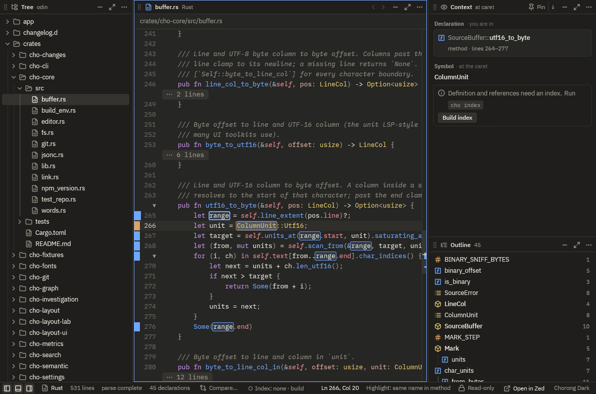

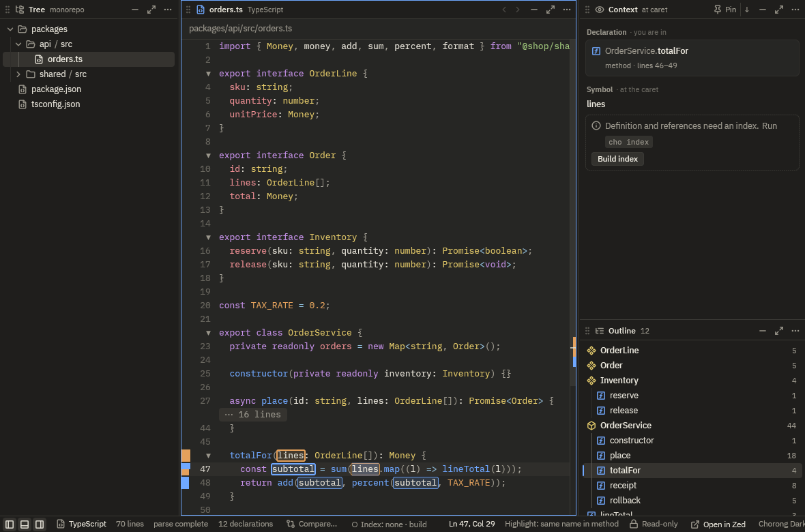

With an index the same double-clicks mark exact symbols:

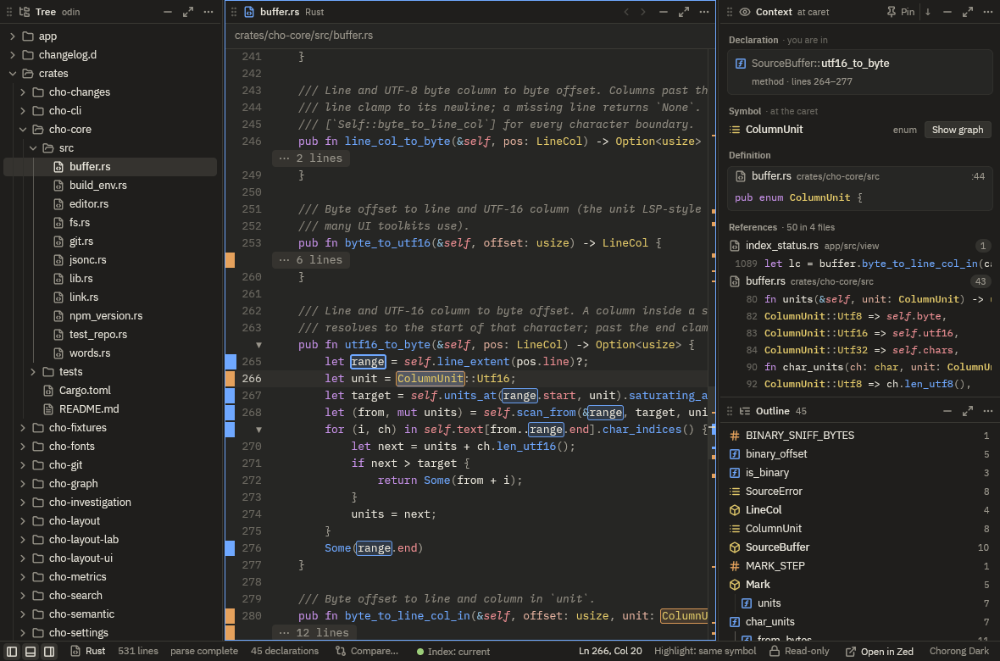

**The Highlights pane.** The active code pane's highlight groups as a row of chips in their
colours, in the bottom dock by default. Each chip shows the name and where the cursor is among
the occurrences (`3/12`), or the count when the cursor is on none; a name match adds `· name`.
Click the name for the next occurrence, the arrows to step either way, and × to remove that
highlight. **Clear all** in the pane's header removes every group.

- It opens by itself when you add a third highlight, without taking the keyboard from the code
  (not in a focus layout, where it would join the page). Cmd-K Shift-H (**Toggle Highlights
  Panel**) shows or hides it at any time.
- When the last highlight goes (Clear all, Clear Highlights, Esc twice, ×), it hides again: alone in a dock, the
  dock hides and keeps its size for next time; elsewhere the pane closes.
- Alone in the bottom dock it opens one row of chips high. Like any pane it can move to a side
  dock (the chips wrap), join a tab group or go on a focus page.

### The context pane

The pane at the top right follows the caret, or the identifier under the pointer (see below).
It always shows the **enclosing declaration** (`Declaration · you are in`) as a card: its kind
glyph, qualified name, kind and line range. Under `Symbol` is the identifier at the caret (or
under the pointer). Without an index it then says "Definition and references need an index.
Run `cho index`." and offers a **Build index** button (see
[Semantics](#semantics)). It does not search by name instead.

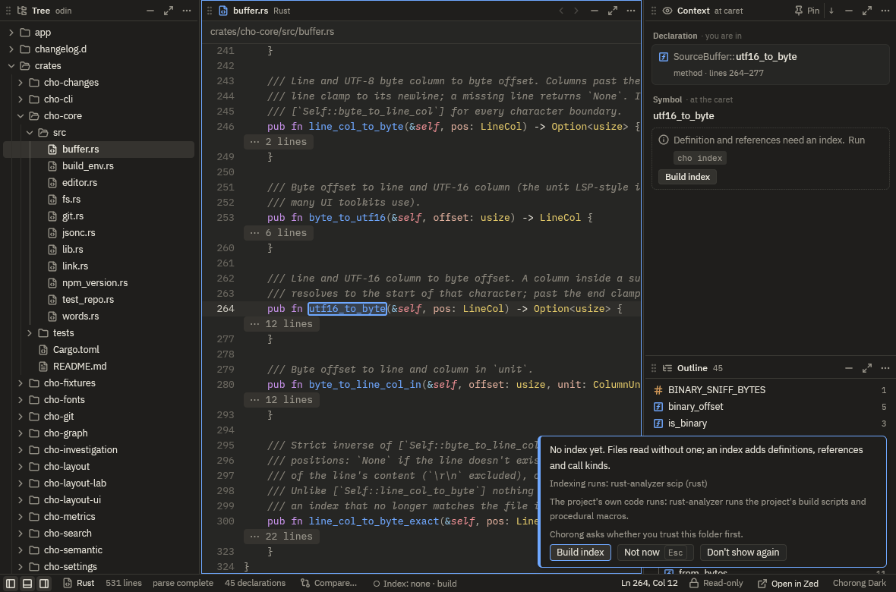

With an index the Symbol line also shows the symbol's kind and a **Show graph** button, then
the symbol's **definition** (its file and line over the signature) and its **references**,
grouped by file, each file with a count (`References · 14 in 3 files`). Previews are in the
code's syntax colours, with the symbol itself in its kind's colour. A symbol with hundreds of
references scrolls as smoothly as one with three: the pane builds only the rows on screen,
and colours each reference line the first time it scrolls into view. When the index is stale
a warning note says results may be out of date. Click a row to open it. The caret lands on the symbol,
which is outlined in the accent colour until the caret moves (not while a tour step is open in
the file: the step's tint shows what it is about), and history records the jump, so
Alt-Left returns you to where you were. Long names are clipped to the pane's width, so the
**Show graph** button stays in view.

**From the keyboard.** Shift-F12 (or `r` in the code view) reports the number of references
and moves the keyboard into the pane's list, on the first reference; the heading reads
`References · N in M files · keyboard`. Up and Down choose a row, Enter opens it and keeps the keyboard
in the list, so the next reference is one key away; Escape (or a click in the source) gives
the keyboard back to the code.

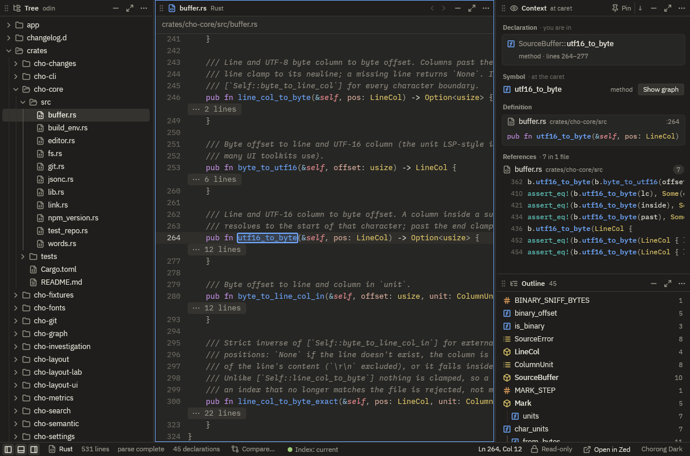

The same in a TypeScript monorepo (pnpm-style workspace packages resolved through `tsconfig`
paths): the caret is on `add` in `packages/api`, and the definition and references come from
`packages/shared` as well, because the index follows imports across packages.

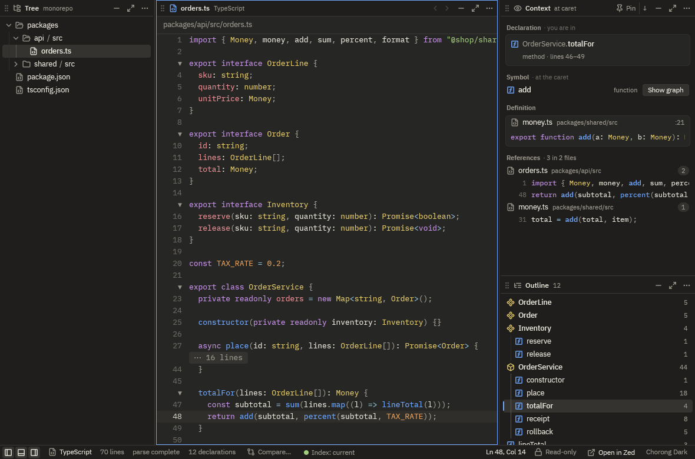

When the workspace's packages export their build instead (`package.json` `types` or `exports`
pointing at `dist/*.d.ts`), the indexer names the built declaration, not the source. Chorong maps
it back to the source declaration in the other package, checking that the source file defines
the same name, and says so under the definition: **mapped (unverified): declaration map** (or
`tsconfig`, `source field`, `path swap`; `through re-exports` for bundled declarations). The
references list then covers both: uses through `dist` from every package, and the source
package's own. Hover shows the source signature, and graph edges built this way are labelled
`mapped`. See [semantic.md](semantic.md#built-declarations-in-workspaces-dist-to-source).

**Hover.** Rest the pointer on an identifier for about 0.3 seconds and the pane follows it
instead of the caret; its title reads `Context · hovering`. Moving over blanks or other
text keeps the last hovered identifier. You can move the pointer from the source into the
pane to click one of the hovered symbol's references: identifiers crossed on the way don't
take over. The pane goes back to the caret when the pointer has left both the source and the
pane, or when you move the caret or click. Lookups run in the background, so moving the
pointer never stalls the viewer. The status bar always shows the caret's position, never the
hover's.

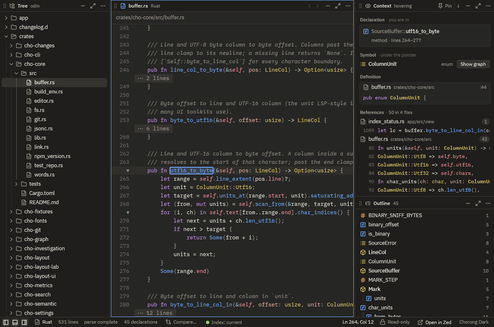

**Pinning.** The Context pane is always live. To keep a symbol while you read on, pin it: the
**Pin** button in the pane's header (or Cmd-K, then P) opens a **pin** pane directly under
Context, and the **↓** beside it (or Cmd-K, then Shift-P) opens the pin as a tab in the bottom
bar. A pin is titled with the symbol and its kind, has a filled pin icon, and shows where the
symbol is (file, line and the commit it was pinned at), its line of code, its definition and its
references. Pin as many symbols as you like.

- Clicking a definition or reference opens it in the active code pane, and back and forward
  (Alt-Left, Alt-Right) record the jump, so you can walk through the references one by one.
- In the bottom bar (or maximised) a pin is wide: the declaration and definition on the left,
  the references in columns by file.
- Drag a pin by its header between the right dock and the bottom bar.
- **×** in its header (or Cmd-K P while the pin has focus, or Cmd-W) unpins it; Cmd-K then Z
  brings it back.
- A pin remembers the file's text when it was taken. If the file changes underneath it (an edit,
  a checkout), the header says `changed since` the pinned commit in the warning colour and the pin
  explains that lines may have moved, rather than silently showing other code. Pins are saved
  with the layout and come back after a restart.

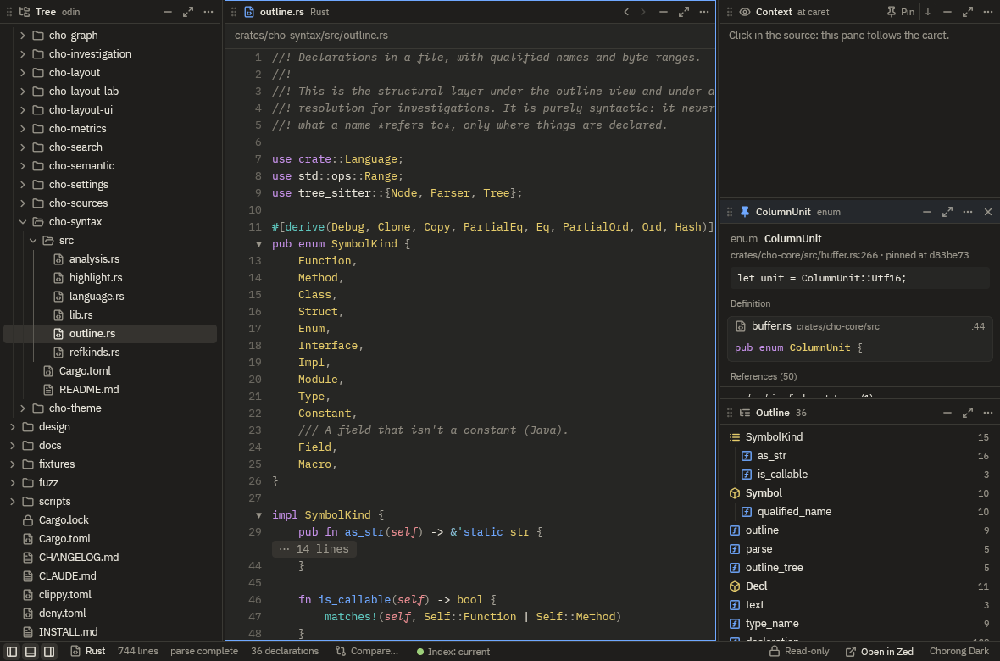

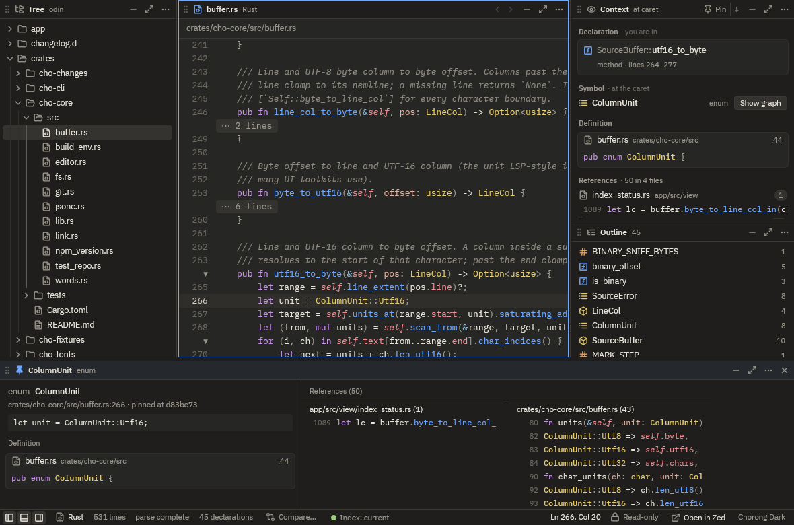

### Critical Lens

Cmd-K, then L toggles the lens. It fades everything to 35% opacity except the names being
called, so the calls in a function stand out. The status bar shows
`Critical Lens` while it is on, with a small legend. It changes how the text is drawn and
nothing else.

With an index, each call is classified by the symbol the index finds at that position:

| Call | Meaning | Drawn |
| --- | --- | --- |
| **repo** | the definition is in your repository | fully bright |
| **external** | a symbol from a dependency: its package is not one of the project's own | slightly dimmed (70%) |
| **unknown** | the index has no symbol there | normal brightness, thin underline |

Your highlights fade less: with the lens on, a highlighted name keeps 65% of its colour in its
box (a highlighted call stays at full colour), so the symbols you are following stand out from
the faded text without competing with the calls.

Unknown calls are never hidden. **Without an index** the lens is plain: every call name stands
out and none is marked, because marking every call "unknown" would only be noise. The status
bar says `call kinds need an index` instead of showing the legend. With an index, the kinds
are filled in a moment after a file opens, once the index has answered; until then the lens
is plain too.

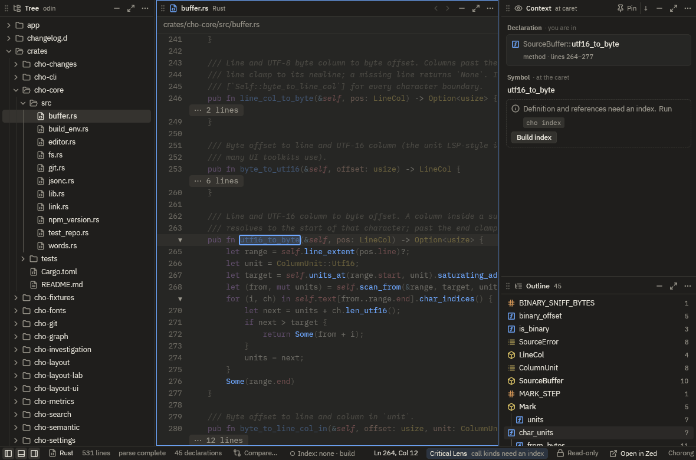

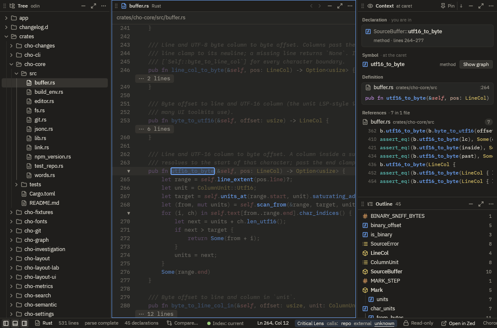

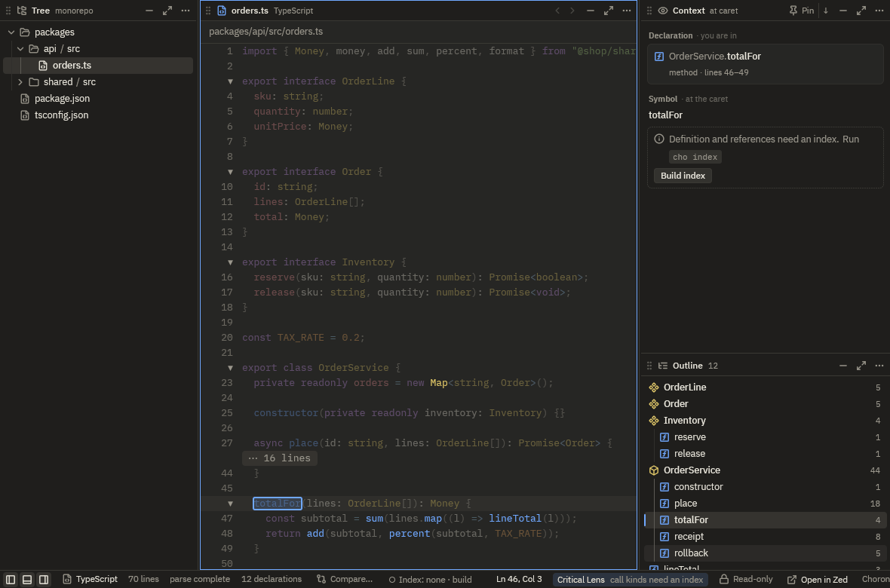

### Blame

Cmd-K, then Shift-B (or **Toggle Blame** in the palette) shows a column beside the gutter of
the code pane you are in saying who last changed each line and when, as `git blame` reports it. Each run of lines from
one commit shows the author's first name and the commit's age once (`Ada 3w`: Ada Lovelace,
three weeks ago; a long name ends in `…`; ages read `now`, `5m`, `3h`, `4d`, `3w`, `5mo`, `2y`). The column is shaded by
age within the file, so the most recent changes stand out and the oldest fade. Hover a line's
blame for the commit's short hash and summary, the author and their address, and the date in
the author's time zone.

Blame always describes the text the pane shows. Lines that are not in the last commit (edited
or added since) say `new`, and hovering one says which commit it differs from. A pane
showing another revision (the Before side of a comparison, or a link to another commit) is
blamed from that revision. When git cannot blame a file (it is not in a repository, or not at
that revision, such as the Before side of a renamed file), the pane header says why and the
column stays away. In a shallow clone, a commit at the edge of the history is marked as such
on hover: the line may be older.

Blame runs in the background, once per file, commit and text; the answer is remembered for the
rest of the session, so switching back to a file is instant. When the window comes back to the front, panes on the
checkout check `HEAD` again, so a commit made meanwhile is picked up. Each code pane has its
own Toggle Blame, so the column takes room only where you asked for it. It is the
`blame.enabled` setting, and off in Lightweight mode (see
[Settings](settings.md)).

### Status bar

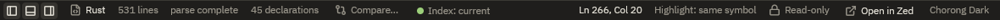

From left to right, with colour only where something needs attention:

| Field | Meaning |
| --- | --- |
| `Loading…` | The file is being read, highlighted and outlined in the background. |
| Language, `N lines` | The detected language (with the file's icon) and line count. |
| `parse complete` / `partial parse` | Whether the syntax tree has errors (`partial parse` has a warning icon and colour). Partial means some of the file did not parse; highlighting and the outline may be incomplete. |
| `N declarations` | Declarations found, as listed in the outline. |
| `Index: ...` | `none`, `current`, `stale` or `failed`; `loading` while the cache is read. A dot in front differs by shape and colour: solid green for current, warning colour for stale, error colour for failed, a hollow ring for none and a dashed ring while loading or building. In Lightweight mode it reads `Index: off (Lightweight)`. It is also a button: click it to build or refresh the index, or to see why a build failed. While a build runs it shows the project and progress. See Semantics. |
| `Ln L, Col C` | The caret. The column counts characters. |
| `Highlight: ...` | Which highlight mode was used last. Only shown once you have highlighted something. |
| `Critical Lens`, `calls: repo external unknown` | A tinted chip shown while the lens is on, with the legend for the three call styles. Without an index it reads `call kinds need an index` instead. |
| `Lightweight` | A tinted chip with a feather while Lightweight mode is on (see [Settings](#settings)). |
| `Read-only` | Always, with a lock. Chorong never edits. |
| A short notice | Briefly, after a command that has no feature behind it yet ("... not available yet") or when an index build ends. |
| **Open in Zed** | At the right: opens the selected line in your editor. |
| Theme name | The active theme. |

At the far left are three dock toggles (left dock, bottom bar, right dock); a refused layout
action shows its reason as a notice.

## Semantics

Without an index, Chorong knows the syntax of a file: structure, folds, outline, highlighting.
Go-to-definition and references come from a **SCIP index**, built in batch by an indexer
(rust-analyzer, scip-typescript or scip-python). There is no language server.

### Building an index from the viewer

Nothing builds until you ask, even in a folder you trust: the file you open reads and highlights
at once, as in an editor. When the folder has something to index and no index, a banner (a card
at the bottom right of the window) says what a build runs (the indexers, for example
`rust-analyzer scip (rust)`), whether the project's own code runs, and how long the last build
took. Its **Build index** button starts the build (in a folder you haven't trusted yet it asks
first); **Not now** hides the banner for this window. While it is up, Esc in the code presses
**Not now**, as the key hint on the button shows (Esc closes the banner before it restores a
focus layout or clears highlights). Enter keeps its meaning in the code: no key starts a build
from the banner, so indexing never starts by accident. **Don't show again** hides it in every window
(the `index.banner` setting; turn it back on in Settings). Without the banner, build or refresh
from the status bar's Index item, Cmd-K I or the palette.


You can also click **Index: none** in the status bar, press Cmd-K then I, use **Build index** in
the context pane, or run **Build Index** from the command palette. The build runs in the
background, one project at a time, with progress in the status bar, and the viewer stays
usable. When it finishes the new index loads in place: the context pane and exact highlighting
start working without reopening anything.

While it runs the status bar says what the indexer is doing and for how long, for example
`Index: stale · indexing packages/core (14 of 38) · 2m 10s`. The elapsed time is always there;
the package and its count appear when the indexer reports them (a package counter shows as
`(14)` when the tool gives no total). A large TypeScript workspace (a pnpm or `workspaces`
project) adds a one-line note: "Large workspace: may take minutes and GBs of memory".
The numbers update every two seconds.

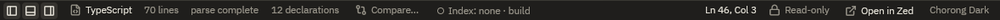

To stop a build, run **Cancel Indexing** from the command palette, or click the status-bar item
(or press Cmd-K then I again) and click it a second time to confirm. Chorong stops the indexer and
everything it started, and the previous index stays in place: the status bar reads
`Index: stale · cancelled`. Build again whenever you like.

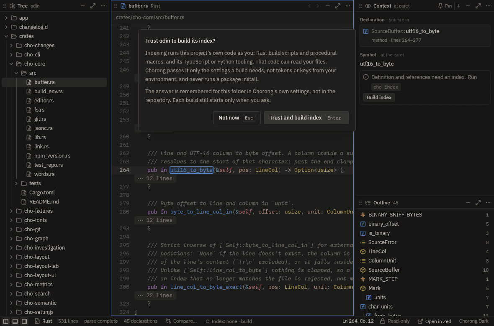

- **Trust, once per folder.** Indexers run the project's own code as you: Rust build scripts
  and procedural macros, and TypeScript tooling that expects `node_modules`. The first build you
  start in a folder asks whether to trust it. Indexers get only the environment variables a build needs,
  not the tokens and keys in your shell (see [Semantic navigation](semantic.md)).
  The answer is remembered by the folder's real path in
  Chorong's own settings (`trusted.json` under `$XDG_CONFIG_HOME/chorong`, or `~/.config/chorong`;
  `~/Library/Application Support/chorong` on macOS), never in the repository. Its git remote is
  recorded too: if the folder's remote changes (another project unpacked or cloned to the same
  path), Chorong asks again and says what changed.
- **A stale index asks too.** When the code has moved on, the banner reads "Index is out of
  date" with **Refresh** and **Keep fresh this session**. The stale index keeps answering,
  labelled stale, until the new one replaces it. **Keep fresh this session** refreshes now and
  whenever the index is stale until the window closes; the `index.auto_refresh` setting does
  that in every session (off by default, and always off in Lightweight mode, where the banner
  still shows without that button). Indexers run at a lower priority than the viewer unless
  `index.low_priority` is off ([settings.md](settings.md)).
- **Chorong never installs packages.** If a TypeScript project lists dependencies and has no
  `node_modules`, the banner warns that imports between packages won't resolve until you
  install them; the project is still indexed. Run your package manager yourself, then refresh.
- **The TypeScript and Python indexers are Chorong's own copies.** The first build downloads
  scip-typescript or scip-python once into Chorong's cache (the status bar reads
  `installing scip-typescript 0.6.0`) and runs it with `node`; nothing in the repository picks
  the program. The versions, and where `node` is, are settings (`index.typescript_version`,
  `tools.node`; see [Semantic navigation](semantic.md#the-indexers-chorong-runs)). Chorong finds
  `node` itself the first time, also when started from Finder or the Dock.
- **Failures are shown.** `Index: failed` opens the end of the indexer's stderr when clicked;
  **Copy error** copies it.
  If the TypeScript indexer runs out of memory, the message names the setting to raise,
  `index.node_memory_mb` (default 8,192 MB; see [settings.md](settings.md)).

The same builds are available without the viewer:

```bash
cho index                  # build or refresh, in the current folder
cho index --root DIR --only rust
cho index status           # none, current, stale or failed, per project
```

`cho index` prints the same progress on stderr (the package or phase, the count and the elapsed
time), and Ctrl-C stops the indexer cleanly and keeps the previous index.

The index is stored in your cache directory, never in the repository. See
[semantic.md](semantic.md) for what is run and where.

- **"Needs an index"** is shown in the context pane when there is none (`Index: none`),
  with a button that builds it.
- **`stale`** means the Git `HEAD` or the working tree changed since the index was built.
  Chorong still uses it and says so, because results may be out of date. Click the status bar
  (or build again) to refresh.
- **`failed`** means the last indexer run failed; click `Index: failed` to see why, or run
  `cho index status`. If no error text was saved (for example, the cache can't be read), the
  status bar reads `Index: failed · build` instead, and a click rebuilds.
- **Chorong never guesses by name.** Where a name match is shown, it is labelled
  `same name in ...`. Definitions and references come only from the index. If the index can't
  answer, the pane says so.

## Opening code elsewhere

Chorong does not edit. Click **Open in Zed** in the status bar to open the selected line, within
the folder you opened, in another editor. Pick the editor when you start the viewer:
`chorong-app --editor code`. Supported: Zed (`zed`), VS Code (`code`), Cursor (`cursor`),
Sublime Text (`subl`), Xcode (`xed`) and the JetBrains IDEs (`rustrover`, `webstorm`,
`pycharm`, `idea`). The button names the editor you chose.

For GitHub and Bitbucket, `cho web-url --repo github:owner/name --rev SHA --path src/lib.rs
--line 42` prints the link to the same line on the web host. See
[external-editors.md](external-editors.md). There is no web-host button in the viewer yet.

## Themes

Chorong starts in **Chorong Dark**, a warm dark theme. `--light` selects Chorong Light.

```bash
chorong-app --light .
chorong-app --theme ~/.config/zed/themes/one.json --theme-name "One Dark" .
cho theme FILE            # validate a Zed theme and list its themes
```

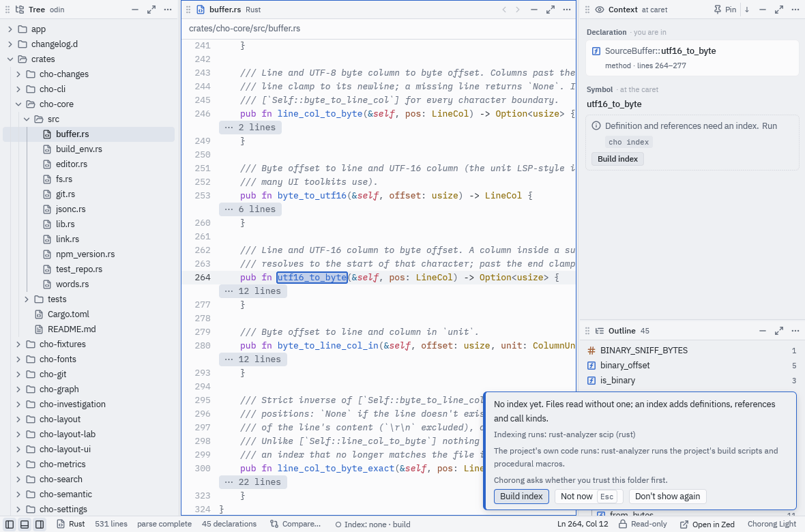

Any Zed theme file (schema v0.2.0) works; `--theme-name` picks one when the file has several,
and the first is used otherwise. Syntax and panel colours come from the theme, and the
highlight colours come from its `players`. See [theming.md](theming.md).

**Fonts.** Chorong ships with IBM Plex Sans for the interface and IBM Plex Mono for code, so it
looks the same on every machine. To use another font, open Settings and pick from the fonts
installed on your machine under `appearance.ui_font` or `appearance.code_font` (or set them in
`settings.json`). A font that isn't installed falls back to IBM Plex. A new font applies
everywhere at once, pane headers and tabs included.

## Settings

Press **Cmd-,** (Ctrl-, on Linux) or run **Settings** from the command palette. Settings opens
in its own window, so the code stays where it is. Press it again and the same window comes
forward; Esc or Cmd-W closes it.

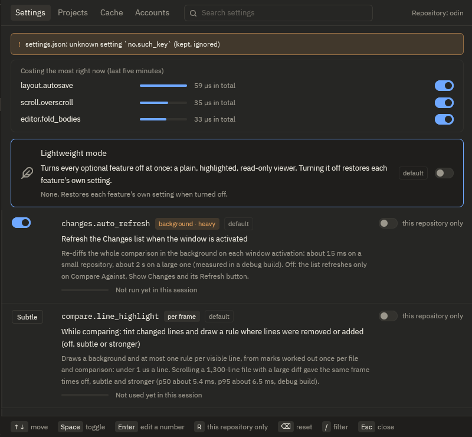

Every optional feature has a row: a switch (or a number), what it does, what kind of work it
costs, what it has actually cost on your machine in this session, and where its value comes
from (`default`, `settings.json`, `this repository` or `Lightweight`). Changes apply at once
and are written to `settings.json`, keeping your comments and the order of the file.

- **Lightweight mode** (the card at the top, or **Toggle Lightweight Mode** in the palette)
  turns every optional feature off for a plain, highlighted, read-only viewer. The status bar
  shows `Lightweight` while it is on.
- **Costing the most right now** lists the three features that took the most time in the last
  five minutes, each with its switch.
- **This repository only** keeps a change for the folder you opened the window from, in Chorong's
  config directory and never in the repository.
- A font setting shows a sample in the chosen font and a list of the installed fonts to pick
  from.
- Keys: Up and Down move, **Space** flips a switch, **Enter** edits a number, **R** switches the
  row to this repository only (and back), **Backspace** resets it, and typing (or `/`) filters
  the rows.

If `settings.json` has a syntax error, the window says where and Chorong keeps the last good
settings and does not overwrite the file. Unknown keys are kept and listed.
See [settings.md](settings.md).

### Projects, Cache and Accounts

The same window has three more sections in its header: **Projects** (protocol, worktrees kept,
the prepare approval and automatic prepare of each remote project, and removing one), **Cache**
(how much disk the clones and worktrees take, and clearing them) and **Accounts** (host tokens:
add, check and remove). Tokens can be added from **Settings, Accounts**; they go to the system
keychain and are never shown again.

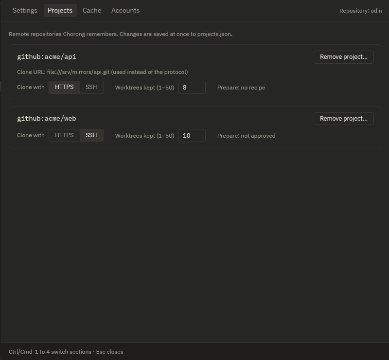

## The CLI, for agents

`cho` is a headless command line with `--json` output and no display needed. It runs the
same engine as the viewer: `cho outline`, `show`, `find`, `highlight`, `index`,
`definition`, `references`, `symbols`, `search`, `investigation check` and more. Use it from scripts
and coding agents. The full list, with exit codes, is in [cli.md](cli.md).

## Tours and call stacks

An **investigation** is a file of claims about code, usually written by an agent: a **tour**
(a reading order through related code), a **call stack** (one path through the code,
outermost call first) or a **comparison** (two or more paths that do the same job, side by
side). The format is in [investigation-format.md](investigation-format.md).
Chorong checks every anchor against the code and labels it; it never changes the file.

**Opening one:**

- **Open Investigation…** in the command palette lists this repository's
  `.chorong/investigations/` first, then the ones you opened recently. Each row shows the title,
  kind, pinned commit, where it comes from (a path, or the host of a URL) and how many anchors
  are broken. A recent whose file is gone is shown as missing.
- **Open Investigation File…** opens any `.json` file.
- A `chorong://investigation?src=…` link (an absolute path, or an `https://` URL) opens it in the
  window for its repository, or in the running viewer from a terminal or a web page. A URL is
  fetched once, over https only, with a size limit and a timeout and no credentials, and its
  host is shown in the list.
- Nothing in an investigation runs anything, and opening one never starts indexing or fetches
  anything but the file itself.
- **Close investigation**, in the ⋯ menu of the Tour, Call stack or Comparison pane (or the
  command palette), closes it and those panes; the files you opened stay open.

A **tour** opens in the Tour pane above the file tree:

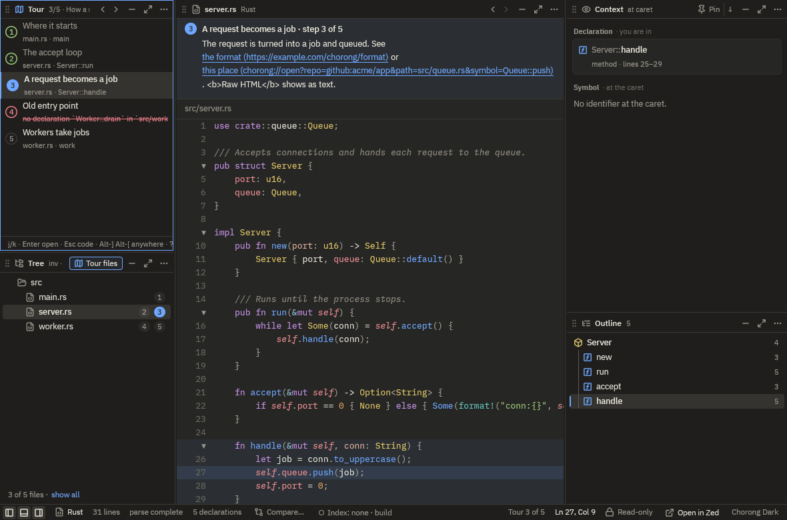

- Steps are listed in order with numbered badges: done (outlined green), current (filled),
  to do (outlined), broken (outlined red). A broken step is shown, never skipped: its location
  is struck through and replaced by the reason.
- The header shows `3/5`, and so does the status bar (`Tour 3 of 5`). The arrows in the header
  go to the previous and next step.
- The current step opens its file at the anchor: the lines it covers are tinted, folds inside
  it are opened, and its note is shown above the code. When the anchor pins one place inside its
  declaration (an `excerpt`, or `from` and `to`), those lines get a stronger tint.
- **The tour filters the file tree** to its files, with each file's step numbers beside it and
  `3 of 5 files · show all` at the end. The **Tour files** chip in the tree's header (or
  **show all**, or **Toggle Tour Files** in the palette) turns the filter off and on.

A **call stack** opens as a tab in the bottom bar:

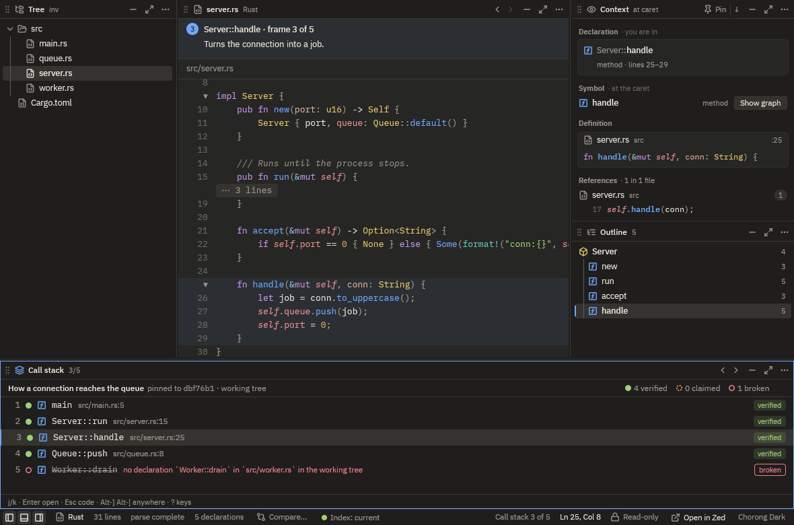

- Each frame shows its index, a status dot, the function glyph, the qualified name, where it
  is and a verification chip. The header gives the title, the pinned commit and how many
  frames carry each label.
- Labels differ by shape as well as colour: **verified** is a solid dot and a filled chip;
  **claimed** a dashed dot and a dashed chip, with the name underlined by a dashed line;
  **broken** a hollow dot, the name struck through and the location replaced by the reason.
- The first frame is verified when its anchor names exactly one declaration. Each later frame
  is verified only when the index confirms the call into it from the frame before. That needs
  the working tree to be the code shown and the index to be current (`Index: current`); at the
  pinned commit, without a current index, or when the file claims no such call, it is
  claimed.
- Selecting a frame opens it, with the tint and the note, like a tour step.

A broken step or frame says why, above the code:

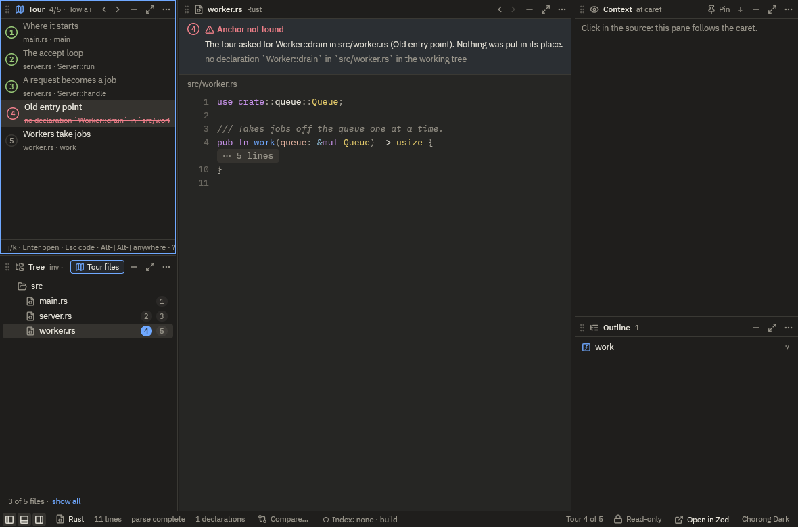

**Tour focus pages.** **Open Tour as Focus Pages** (Cmd-K Shift-T, or the command palette)
turns the tour into a focus layout with one page per step:

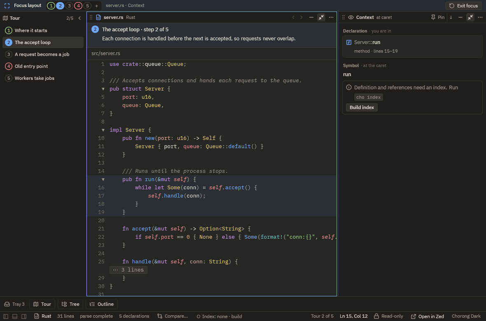

- Each page shows the panes the step asks for (code, Context or a symbol pinned by the tour,
  Outline, the call stack, the file tree, a graph of the step drawn from the index), laid out
  by Chorong from a named arrangement
  (`single`, `side-by-side`, `stacked`, `main-side`, `grid`). A tour never gives sizes or
  positions, so the same tour always gives the same pages. A step that asks for nothing gets
  the default page: the code at its anchor, with Context beside it.
- The page strip uses the step badges (done, current, to do, broken). Going to a page makes
  its step current, and stepping the tour (Alt-] and the rest, or a click on a step) goes to
  its page.
- The **tour rail** stays at the left of every page. The arrow in its header collapses it to
  a column of badges.
- Rearrange a page as you like: your version is kept for the session, and its chip shows a
  dot. **Reset Focus Page** (Cmd-K R) lays it out as the tour asked again. Pages you add (`+`)
  come after a divider with dashed chips; stepping the tour skips them. The tour file never
  changes.
- **Exit focus** (or Restore layout) puts the docks back with the Tour pane at the step you
  reached and the tree still filtered; the code pane you were reading keeps your place, and
  the other panes the pages opened close.
- An anchor in a page that is not found is a card that says what was asked for and why, never
  dropped or replaced:

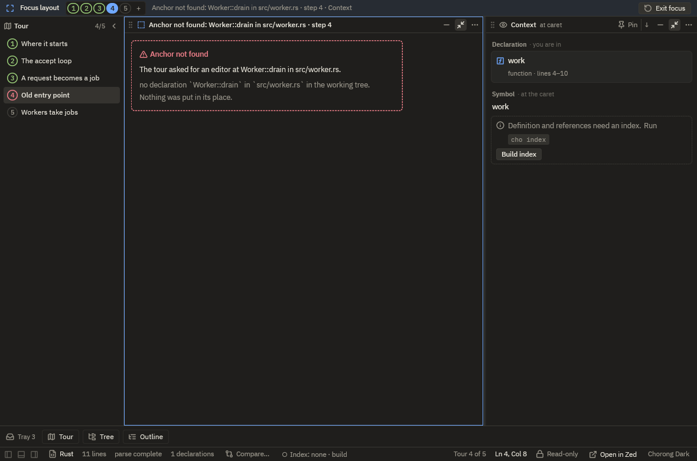

**Format version 2.** Investigations written in format version 2 can also say:

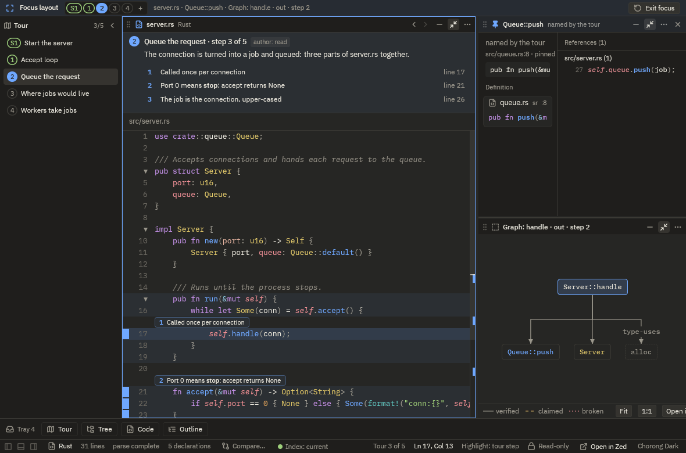

- **Several highlights in one file:** each chunk tints its declaration faintly and its
  excerpt (or `from` / `to` range) darker, with a numbered strip just above the excerpt's
  first line (a whole-declaration chunk's first line) holding the author's label. Chunks that
  share a declaration each keep their own strip and their own stop for `n` / `N`. The step's own anchor is not tinted then: it names the step, and
  the editor opens on chunk 1. Under the step's note, a numbered list of the chunks (in the
  author's reading order, each with its label, the author's commentary under it, and its
  line) goes to a chunk when you click its row. The chunks form a
  highlight group (**Step 3 highlights** in the Highlights pane), so `n` / `N` move between
  them in file order (in the code, or with the keyboard still in the Tour or Call stack pane).
  Your own highlights don't replace them: on a name you highlighted, `n` / `N` go through
  yours, elsewhere in a chunk through the chunks, and `h`, Esc and Clear Highlights remove only
  yours while the step is open.
- **The banner** above the code (the step's note, and its list of chunks) fits its text up to
  a few lines and scrolls beyond that, springing back at its ends like the panes. Drag its
  bottom edge to make it taller or shorter for every pane in the window; it is never taller
  than its text, so a shorter step shrinks it. When text is hidden below the fold, a **More**
  chip in its corner grows it to show everything. Double-click the edge to go back to the
  default height.
- **Nodes that are not in the code** (a model, a database, a vendor): listed with a box glyph
  and `not in the code` in place of a location, and never a verification label. On a page
  they are a small card instead of an editor; opened in the normal layout, the same card
  covers the code (Back returns to the file under it).

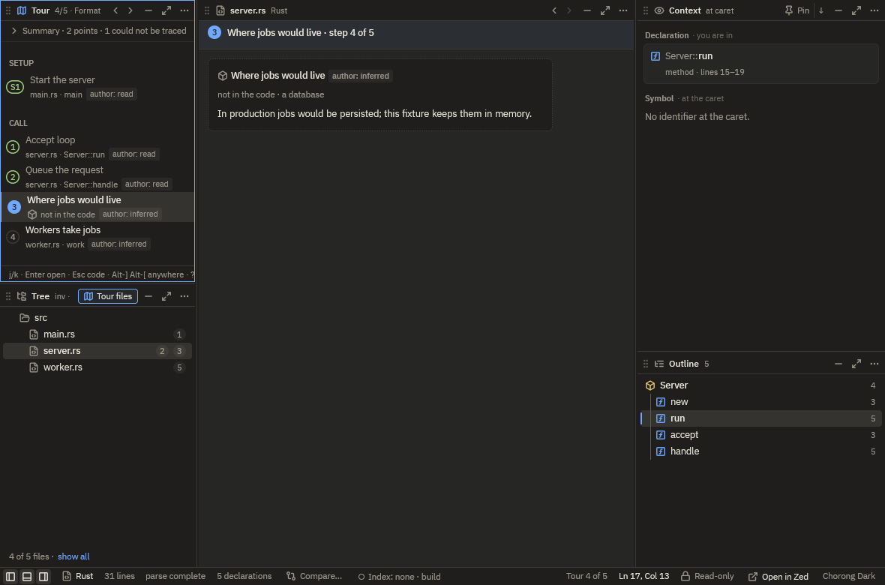

- **Action steps:** a step that is something to do by hand, such as "run the migration". It is
  listed with a `$_` glyph and `to do by hand · 2 commands` in place of a location, and never a
  verification label. Opened, its card replaces the code (Back returns to the file under it):
  the author's note, then each command in a monospace block with a **Copy** button. Copy puts
  exactly that command on the clipboard and reads **Copied** for a moment. **Chorong never runs a
  command**: there is no Run button, because an investigation file is untrusted.

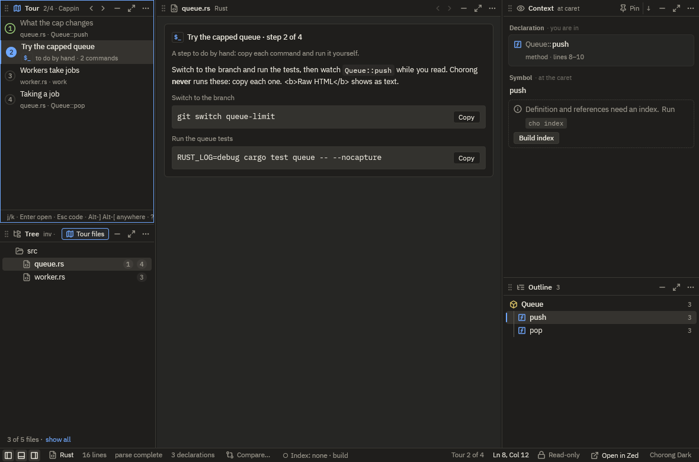

- **An action step's page** has the card as its main pane, and any panes the step asks for sit
  beside it, so "run this, then watch this code" reads on one page:


- **Diff panes:** a page can show how one file changed between two revisions (a branch, tag
  or commit, or the working tree). The pane is the file on its newer side with the change marks
  of **Compare against…**: changed lines tinted, changed words marked, the folds around them
  opened, and the caret on the first change. A revision the repository doesn't have is a card
  saying so; Chorong never picks another one.


- **Phases:** setup steps are numbered S1, S2… under **SETUP**, then the call steps 1, 2…
  under **CALL**.
- **The author's evidence** (`author: read`, `author: inferred`) as a small grey tag beside
  Chorong's own label, which it never changes. **Runtime values** the author saw (`full = false`)
  show beside the step's note, outlined dashed like any claim.
- **Short step names** in the lists, with the full note above the code; **summary points**
  and a **could not be traced** list in a line at the top of the Tour and Call stack panes,
  which opens to show them.

**Comparisons.** A comparison (format version 2) opens in the **Comparison** tab of the bottom
bar: one row per step, one column per side, and the result of each row.


- Each cell shows the side's step by its short name (or its declaration), the file and
  declaration under it, and the author's runtime values outlined dashed, like any claim. A
  side with no step for the row shows `∅` and the author's reason; a node that is not in the
  code shows its box glyph.
- The **result** differs by shape as well as colour: `= same` (a filled grey chip), `≠
  differs` (a tinted chip), `∅ missing` (dashed). Beside it, **derived** means Chorong worked it
  out (a side has no step, or every side runs the same declaration and the author wrote
  nothing), **claimed** that it is the author's; **same code** says every side anchors the
  same declaration (a fact, even when the author says the row differs by values). The
  tooltip gives the reason for a missing side and what the check found.
- Setup rows (S1, S2…) are their own group, before the call rows; a group's heading folds it.
  A **callout** the author wrote ("Paths split here") is a red line under its row.
- The header gives the title, the pinned commit and which code is read, and the counts
  (`2 differ`, `1 missing`, `2 same`); click a count to show only those rows.
- Enter on a row opens its **focus page**: one code pane per side, each at its anchor with the
  lines tinted, and a strip above each saying which side it is, the row's result and callout,
  and the side's values. A missing side or a node not in the code is a card that says so.
  Esc (or **Exit focus**) returns to the tab.


**A comparison as a tour.** **Open Comparison as Tour** (Cmd-K Shift-C) shows the same pages
as tour steps, one per row, with the rail listing the rows and their results. Step through
them like any tour (Alt-] and Alt-[, or the page strip).


**Variants.** A side can have **variants**, other versions of it (one per tool, scenario or
configuration) that replace only some of its rows. A side that has variants gets a picker
in the Comparison tab's header (and in the rail): choose one and that side's rows, results
and callouts are drawn again from the last check, without checking again. `v` in the tab
moves to the next variant of the first side that has any. The variant's note is shown under
the picker and its label in the column heading.


**Tour branches.** A tour can have **branches**: other paths through it, such as "when the
port is 0". The Tour pane's header (and the rail on focus pages) has a **Path** picker; `b`
in the Tour pane moves to the next branch. On a branch:


- A step the branch replaces shows the other code in its place, with the branch's values.
- A step the branch does not reach stays in the list, **muted, with `not reached` and the
  author's reason**; it is never hidden. Stepping the tour (j / k, Alt-] and the rest, the
  page strip) skips it, and it has no focus page.

Chorong remembers the branch and the variants you chose for each investigation, in its own
settings folder (like your place), and drops a choice the file no longer has.

**Keys.** In the Tour, Call stack and Comparison panes: `j` / `k` (or Down / Up) move, Enter
opens, Esc goes back to the code, `n` / `N` step through the current step's highlighted chunks
in the code; `b` chooses the next tour branch and `v` the next variant.
From anywhere while an investigation is open: Alt-] and Alt-[ go to the next and previous
step, Alt-Home and Alt-End to the first and last; Cmd-K Shift-T opens a tour as focus pages,
Cmd-K Shift-C a comparison as a tour. Each pane shows a one-line hint, and `?` lists them
under **Tour and call stack** and **Comparison, variants and branches**.

**When the code has moved on.** If the checkout isn't at the investigation's commit, Chorong asks
which code to use: the **pinned commit** (read from git, read-only, like View at a commit) or
the **working tree**. Labels describe the code you chose; nothing is re-anchored silently.

**When the file changes.** Chorong watches the open investigation file and shows **Updated ·
Reload** when a newer version parses; it never swaps the content by itself. Reload keeps the
current step if it is still there. The `investigations.watch` setting turns this off (it is off
in Lightweight mode).

**Notes** are Markdown shown as inert text: `code`, links, and `**bold**` or `*italic*`
(also `__bold__` and `_italic_`, by CommonMark's rules, so `snake_case_names` stay as written).
Raw HTML shows as text, images are never loaded, and a link shows its real target and opens only when you click it
(`chorong://` links go through the same checks as any other link; `https://` opens in your
browser; anything else is not opened). The same applies to highlight labels and their
commentary, summary bullets, and a comparison's callouts and variant notes; in those short
places (and in tooltips) a link shows its target but is not opened.

Chorong remembers recently opened investigations (20 per repository) and your place in each, in
its own settings folder, never in the repository.

## Graphs from the viewer

With an index, press Cmd-K, then G (or **Show Graph** in the palette, or **Show graph** in
the context pane) to draw who uses a symbol and what it uses. A popover asks where to start:


- **Symbol**: the one under the pointer, pinned in the pane, or at the caret (exactly as the
  index knows it). **File** and **Package of this file**: their edges, at package level.
  **Changes on this branch** (when your branch has commits the main branch hasn't): the
  blast radius of those changes, with the tests that reach them.
  Right-click a file in the Tree pane, or click the file path above the source, to start from
  that file.
- **Direction** (both, who uses it, what it uses), **depth** in hops, and which **edge
  kinds** to draw. **For sharing** leaves the branch, uncommitted-changes flag and worktree
  name out of the page. The choices are remembered.
- Enter builds the graph in the background; the viewer stays usable. The page opens in
  your browser and a note above the source shows where it was written (in Chorong's cache
  folder, under `graphs/`), with **Open again** and **Copy path**.

The page is the same as `cho graph --html` makes (below). Its links open the declaration
back in Chorong.

**In a pane** (beside **Show graph**, for a symbol) draws the graph inside Chorong instead, in a
graph pane in the bottom bar: a simple, static drawing laid out by Chorong. Solid lines come from
the index; dashed lines are claimed, dotted red ones broken; boxes with a dashed outline are not
in your code. **Fit** fits it to the pane, **1:1** shows it at full size, and **Open in browser**
opens the full page. Click a box to open its declaration.


## Graphs from the CLI

With an index (`cho index`), `cho graph` draws who uses a symbol and what it uses as an HTML
page that works offline:

```bash
cho graph --symbol cho-syntax:find_symbol --html graph.html      # neighbourhood
cho graph --symbol check_with_oracle --closure --html closure.html  # what it depends on
cho graph --diff main..HEAD --blast-radius --html pr.html           # who a branch could affect
cho graph --symbol find_symbol --out --svg graph.svg               # the graph pane's drawing, as SVG
```


The page starts small and readable:

- **Tests are hidden** (the toolbar says how many), except in a blast radius, where the tests
  that reach the change matter. Tick **tests** to show them.
- **Only lines that lead to what you graphed** are drawn. Lines between things that are merely
  both in the picture (a caller also using another type in the same file) are behind
  **other lines**.
- **Many callers or uses** show 10 and a **+N more** box: a click shows 10 more, the next click
  opens all of them on their own (grouped by file when there are many), with **Back**.
- **Package level** shows each package as one box; the line's thickness is how many
  references it stands for, and its number how many different things it uses in the package
  it points to (on a small graph the number is in the box). Double-click a box to open it.
- **Click a line** for what it uses and where from, each with its reference count. Click a
  symbol for **Used by** and **Uses**; click a package or file for the same, grouped by the
  other package.
- A graph too big to read at full size opens on what you graphed at a readable size, with an
  overview map in the corner; **Fit** shows all of it.

Click a node for its `chorong://` link and `cho open` command, hover to light up its edges, and
untick an edge kind (such as `type-uses`) to see runtime coupling. The page header records the
worktree, branch, commit and whether there were uncommitted changes, and says what a static
graph cannot see. Links in the page name the repository by its remote (such as
`github:acme/api`), never your local path.

A page in Chorong's cache folder (the default) loads its two drawing libraries from a copy beside
it, so it is about 150 KB; a page written elsewhere with `--html` has them inside. Add `--share` for a page that leaves your machine: it puts the libraries inside the
page (about 2 MB, works anywhere), keeps the repository and commit and leaves out the
worktree, branch and uncommitted-changes flag. `--inline` puts the libraries inside without
the rest. `--json` prints the same graph for agents, `--dot` prints Graphviz. See
[graph.md](graph.md).

## Key bindings

`Cmd` is Ctrl on Linux and Windows. All defaults live in one file,
[`app/keymap/default.json`](../../app/keymap/default.json), in Zed's keymap format; the table
below is generated from it (a test fails when they drift), and the viewer's palette, popup,
cheat sheet and tooltips read bindings from the same keymap. The plan and the reasoning
are in [keybindings.md](keybindings.md).

Single letters are bound only while the code view has focus; in pickers, the palette and the
search field they are typed as text.

<!-- keymap-table -->
**Go somewhere**

| Action | Linux / Windows | macOS |
| --- | --- | --- |
| Go to File | Ctrl-P | ⌘P, ⌃⌘N |
| Command Palette | Ctrl-Shift-P | ⇧⌘P |
| Go to Symbol in File | Ctrl-Shift-O | ⇧⌘O |
| Go to Symbol in Project | Ctrl-T | ⌘T, ⌘N |
| Go to Line | Ctrl-G | ⌃G |
| Go to Definition | F12, D | F12, D |
| Find References | Shift-F12, R | ⇧F12, R |
| Go Back | Ctrl-[, Ctrl--, Alt-Left | ⌘[, ⌃- |
| Go Forward | Ctrl-], Ctrl-Shift--, Alt-Right | ⌘], ⌃⇧- |
| Switch to Recent Pane | Ctrl-Tab | ⌃Tab |
| Find in File | Ctrl-F | ⌘F |
| Search the Project | Ctrl-Shift-F | ⇧⌘F |
| Open File or Folder… | Ctrl-O | ⌘O |
| Go to Pane Left | Ctrl-K Ctrl-Left | ⌘K ⌘Left |
| Go to Pane Right | Ctrl-K Ctrl-Right | ⌘K ⌘Right |
| Go to Pane Up | Ctrl-K Ctrl-Up | ⌘K ⌘Up |
| Go to Pane Down | Ctrl-K Ctrl-Down | ⌘K ⌘Down |

**Change the view (key chords)**

| Action | Linux / Windows | macOS |
| --- | --- | --- |
| Toggle Critical Lens | Ctrl-K L | ⌘K L |
| Toggle Blame | Ctrl-K Shift-B | ⌘K ⇧B |
| Toggle Hide Tests | Ctrl-K H | ⌘K H |
| Toggle Outline Panel | Ctrl-K O | ⌘K O |
| Toggle Highlights Panel | Ctrl-K Shift-H | ⌘K ⇧H |
| Toggle File Tree | Ctrl-K B | ⌘K B |
| Add to Page from Tray or Files… | Ctrl-K A | ⌘K A |
| Grow Dock | Ctrl-Alt-= | ⌃⌥= |
| Shrink Dock | Ctrl-Alt-- | ⌃⌥- |
| Reset Dock Size | Ctrl-Alt-0 | ⌃⌥0 |
| Maximise or Restore Pane | Ctrl-K M, Shift-Esc | ⌘K M, ⇧Esc |
| New Focus Page | Ctrl-K Shift-N | ⌘K ⇧N |
| Next Focus Page | Ctrl-K ] | ⌘K ] |
| Previous Focus Page | Ctrl-K [ | ⌘K [ |
| Reset Focus Page to Its Tour Step | Ctrl-K R | ⌘K R |
| Undo Layout Change | Ctrl-K Z | ⌘K Z |
| Redo Layout Change | Ctrl-K Shift-Z | ⌘K ⇧Z |
| Pin Context Here, or Unpin | Ctrl-K P | ⌘K P |
| Pin Context to Bottom Bar | Ctrl-K Shift-P | ⌘K ⇧P |
| Show Graph | Ctrl-K G | ⌘K G |
| Close Pane | Ctrl-W | ⌘W |
| Minimise or Restore Pane | Ctrl-K N | ⌘K N |
| Split Pane Right | Ctrl-\, Ctrl-K Right | ⌘\, ⌘K Right |
| Split Pane Down | Ctrl-K Down | ⌘K Down |
| Split Pane Left | Ctrl-K Left | ⌘K Left |
| Split Pane Up | Ctrl-K Up | ⌘K Up |
| Build Index | Ctrl-K I | ⌘K I |
| Toggle Left Dock | Ctrl-B | ⌘B |
| Toggle Right Dock | Ctrl-Alt-B | ⌥⌘B |
| Toggle Bottom Bar | Ctrl-J | ⌘J |
| Toggle All Docks | Ctrl-Alt-Y | ⌥⌘Y |
| Enter Layout Mode | Ctrl-K Space, W | ⌘K Space, W |
| Toggle Frame Stats | Ctrl-K F | ⌘K F |
| Open in External Editor | Ctrl-K E | ⌘K E |
| Open on GitHub | Ctrl-K W | ⌘K W |
| Copy chorong:// Link | Ctrl-K C | ⌘K C |
| Switch Theme | Ctrl-K T | ⌘K T |
| Fold All | Ctrl-K 0 | ⌘K 0 |
| Unfold All | Ctrl-K J | ⌘K J |
| Settings | Ctrl-, | ⌘, |

**Read (single keys in the code view)**

| Action | Linux / Windows | macOS |
| --- | --- | --- |
| Fold, or Go to Enclosing Block | Left | Left |
| Unfold, or Step Into Block | Right | Right |
| Highlight Symbol Under Cursor | H | H |
| Next Occurrence | N | N |
| Previous Occurrence | Shift-N | ⇧N |
| Remove Newest Highlight | Esc | Esc |
| Fold or Unfold Declaration | Space, Enter | Space, Enter |
| Copy | Ctrl-C | ⌘C |
| Copy with Location | Ctrl-Shift-C | ⇧⌘C |
| Select All | Ctrl-A | ⌘A |
| Previous Declaration | [ | [ |
| Next Declaration | ] | ] |
| Show Key Bindings | ? | ? |

**Compare**

| Action | Linux / Windows | macOS |
| --- | --- | --- |
| Compare Against… | Ctrl-K D | ⌘K D |
| Switch Before/After | B | B |
| Link or Unlink Split | Shift-B | ⇧B |
| Next Uncommitted Change | U | U |
| Previous Uncommitted Change | Shift-U | ⇧U |
| Highlight Uncommitted | Ctrl-K U | ⌘K U |

**Tour and call stack**

| Action | Linux / Windows | macOS |
| --- | --- | --- |
| Next Step | Alt-] | ⌥] |
| Previous Step | Alt-[ | ⌥[ |
| First Step | Alt-Home | ⌥Home |
| Last Step | Alt-End | ⌥End |
| Open Tour as Focus Pages | Ctrl-K Shift-T | ⌘K ⇧T |

**Comparison, variants and branches**

| Action | Linux / Windows | macOS |
| --- | --- | --- |
| Open Comparison as Tour | Ctrl-K Shift-C | ⌘K ⇧C |
| Next Variant (comparison side) | V | V |
| Next Branch (tour path) | B | B |
<!-- /keymap-table -->

Other keys: in the picker and palette, Up / Down, Enter and Escape; in search, Up / Down,
Enter, Escape, Alt-C (case) and Alt-R (regex); in the context pane's reference list, Up / Down,
Enter and Escape; in the Changes list, Up / Down, Left / Right (collapse, expand), Enter, Escape
and typing to filter; in the Show graph popover, Up / Down, `d` (direction), `+` / `-` (depth),
`s` (for sharing), Enter and Escape; in a dialog, Enter and Escape.

Mouse: click a line to select it, drag to select text (Shift-click extends, triple-click selects
the line), double-click an identifier to highlight it (and select it), click a fold
row or gutter chevron to fold, click a sidebar, search, outline or reference row to open it,
rest the pointer on an identifier to see its context.
